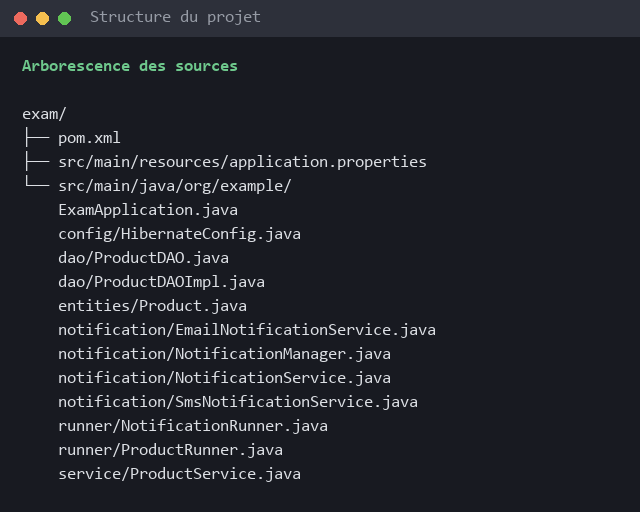
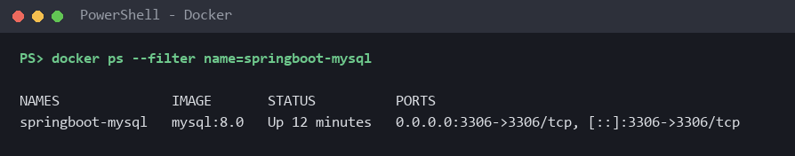
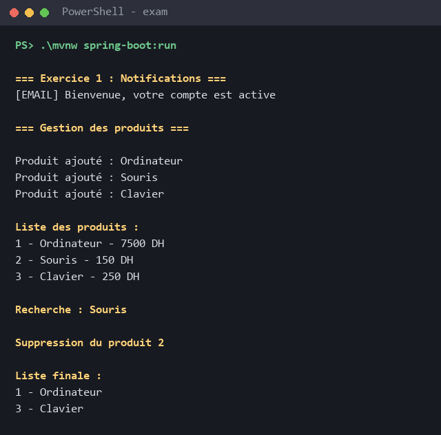
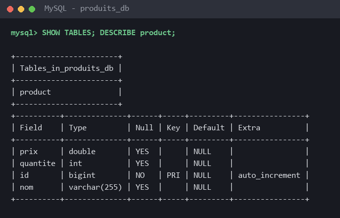
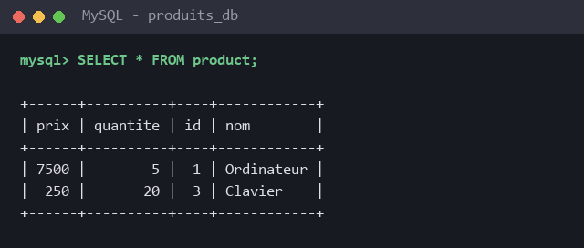

# Examen pratique : Spring IoC & Hibernate

Application Spring Boot en deux parties :

1. **Exercice 1 (Spring IoC)** : envoi de notifications par Email ou SMS, avec injection de dépendances par constructeur et `@Qualifier`.
2. **Exercice 2 (Spring IoC + Hibernate)** : gestion de produits stockés dans **MySQL**, avec Hibernate natif (`SessionFactory` / `Session`), **sans Spring Data JPA**.

## Technologies

| Outil | Version |
|-------|---------|
| Java | 21 |
| Spring Boot | 3.2.0 (spring-boot-starter, starter-jdbc, spring-orm) |
| Hibernate ORM | 6.3 (hibernate-core) |
| MySQL | 8.0 (conteneur Docker) |
| Maven | Maven Wrapper (`mvnw`) |

## Structure du projet

```
src/main/java/org/example/
├── ExamApplication.java                 # point d'entrée @SpringBootApplication
├── notification/                        # Exercice 1
│   ├── NotificationService.java         # interface : envoyer(String message)
│   ├── EmailNotificationService.java    # @Service("email")
│   ├── SmsNotificationService.java      # @Service("sms")
│   └── NotificationManager.java         # @Component, injection par constructeur + @Qualifier
├── entities/
│   └── Product.java                     # @Entity -> table product
├── config/
│   └── HibernateConfig.java             # SessionFactory + HibernateTransactionManager
├── dao/
│   ├── ProductDAO.java                  # interface DAO
│   └── ProductDAOImpl.java              # @Repository, API Session de Hibernate
├── service/
│   └── ProductService.java              # @Service + @Transactional
└── runner/
    ├── NotificationRunner.java          # CommandLineRunner exercice 1 (@Order(1))
    └── ProductRunner.java               # CommandLineRunner exercice 2 (@Order(2))
src/main/resources/application.properties  # connexion MySQL
```



---

## Exercice 1 : Spring IoC (gestion des notifications)

| Élément | Rôle |
|---------|------|
| `NotificationService` | Interface avec la méthode `envoyer(String message)` |
| `EmailNotificationService` | Implémentation Email, annotée `@Service("email")` |
| `SmsNotificationService` | Implémentation SMS, annotée `@Service("sms")` |
| `NotificationManager` | `@Component` qui reçoit un `NotificationService` par son **constructeur** |

Deux beans implémentent la même interface, donc Spring ne peut pas choisir seul. `@Qualifier("email")` sélectionne le service Email :

```java
@Component
public class NotificationManager {
    private final NotificationService service;

    public NotificationManager(@Qualifier("email") NotificationService service) {
        this.service = service;
    }

    public void notifier(String message) {
        service.envoyer(message);
    }
}
```

Le test est fait au démarrage par `NotificationRunner` (`CommandLineRunner`).

---

## Exercice 2 : Spring IoC + Hibernate (gestion des produits)

### Architecture

```
ProductRunner (CommandLineRunner)
        ↓
ProductService     @Service + @Transactional
        ↓
ProductDAO         @Repository (ProductDAOImpl)
        ↓
Hibernate SessionFactory → Session / Transaction
        ↓
MySQL (table product)
```

Chaque couche reçoit la couche inférieure par **injection par constructeur**.

### 1. Modèle de données : `Product`

| Attribut | Type | Mapping |
|----------|------|---------|
| id | Long | `@Id` + `@GeneratedValue(strategy = IDENTITY)` (AUTO_INCREMENT) |
| nom | String | varchar(255) |
| prix | Double | double |
| quantite | Integer | int |

La classe est annotée `@Entity` et `@Table(name = "product")`.

### Partie A : configuration Hibernate

**Connexion MySQL** (`application.properties`) :

```properties
spring.datasource.url=jdbc:mysql://localhost:3306/produits_db?useSSL=false&allowPublicKeyRetrieval=true&serverTimezone=UTC
spring.datasource.username=devuser
spring.datasource.password=${DB_PASSWORD:}
spring.datasource.driver-class-name=com.mysql.cj.jdbc.Driver
```

**SessionFactory** (`HibernateConfig`) : Spring Data JPA n'est pas utilisé, donc Hibernate est configuré manuellement :

- `LocalSessionFactoryBean` construit la `SessionFactory` à partir du `DataSource` et scanne le package `org.example.entities`.
- `hibernate.hbm2ddl.auto=create` : la table `product` est **générée automatiquement à partir de l'entité**.
- `HibernateTransactionManager` + `@EnableTransactionManagement` permettent la gestion des transactions avec `@Transactional`.

### Partie B : couche DAO

`ProductDAOImpl` utilise directement l'API `Session` de Hibernate (aucun `JpaRepository` ni `CrudRepository`) :

| Méthode DAO | Appel Hibernate |
|-------------|-----------------|
| `save(Product)` | `session.persist(product)` |
| `findById(Long)` | `session.get(Product.class, id)` |
| `findAll()` | `session.createQuery("from Product p order by p.id", Product.class)` |
| `delete(Long)` | `session.get(...)` puis `session.remove(product)` |

La session est obtenue avec `sessionFactory.getCurrentSession()`. Elle est liée à la transaction ouverte par le service.

### Partie C : service métier

`ProductService` est annoté `@Service` et `@Transactional` au niveau de la classe : chaque méthode (`ajouter`, `chercher`, `lister`, `supprimer`) s'exécute dans une transaction (commit automatique, rollback en cas d'exception). Le `ProductDAO` est injecté par constructeur.

### Partie D : exécution

`ProductRunner` réalise les étapes demandées :

1. ajout de trois produits (Ordinateur, Souris, Clavier) ;
2. affichage de tous les produits ;
3. recherche d'un produit par son identifiant ;
4. suppression d'un produit ;
5. affichage de la liste restante.

---

## Installation et exécution

### Prérequis
- JDK 21 ou plus
- Docker (pour MySQL)

### 1. Lancer MySQL avec Docker

```bash
docker run -d --name springboot-mysql -p 3306:3306 -e MYSQL_ROOT_PASSWORD=root -e MYSQL_USER=devuser -e MYSQL_PASSWORD=devpass mysql:8.0
```

Créer la base et donner les droits à l'utilisateur :

```bash
docker exec -it springboot-mysql mysql -uroot -p -e "CREATE DATABASE produits_db; GRANT ALL ON produits_db.* TO 'devuser'@'%';"
```



### 2. Lancer l'application

Le mot de passe MySQL est passé par la variable d'environnement `DB_PASSWORD` :

```powershell
$env:DB_PASSWORD="devpass"
.\mvnw spring-boot:run
```

(Linux / macOS : `DB_PASSWORD=devpass ./mvnw spring-boot:run`)

---

## Résultats

### Sortie console



```
=== Exercice 1 : Notifications ===
[EMAIL] Bienvenue, votre compte est active

=== Gestion des produits ===

Produit ajouté : Ordinateur
Produit ajouté : Souris
Produit ajouté : Clavier

Liste des produits :
1 - Ordinateur - 7500 DH
2 - Souris - 150 DH
3 - Clavier - 250 DH

Recherche : Souris

Suppression du produit 2

Liste finale :
1 - Ordinateur
3 - Clavier
```

### Table `product` générée par Hibernate



### Données dans MySQL après exécution

Le produit 2 (Souris) a bien été supprimé :



---

## Respect des contraintes

| Contrainte | Où |
|------------|----|
| `@Component` / `@Service` | `NotificationManager`, `EmailNotificationService`, `SmsNotificationService`, `ProductService` |
| Injection par constructeur | `NotificationManager`, `ProductDAOImpl`, `ProductService`, runners |
| `@Qualifier` pour le service Email | `NotificationManager` |
| `CommandLineRunner` | `NotificationRunner`, `ProductRunner` |
| `@Entity`, `@Id`, `@GeneratedValue` | `Product` |
| `SessionFactory` / `Session` Hibernate natif | `HibernateConfig`, `ProductDAOImpl` |
| `persist()`, `get()`, `createQuery()`, `remove()` | `ProductDAOImpl` |
| `@Repository` | `ProductDAOImpl` |
| `@Transactional` au niveau du service | `ProductService` |
| Pas de Spring Data JPA | aucune dépendance `spring-boot-starter-data-jpa`, aucun `JpaRepository` / `CrudRepository` |
| MySQL | `mysql-connector-j` + conteneur Docker `mysql:8.0` |
