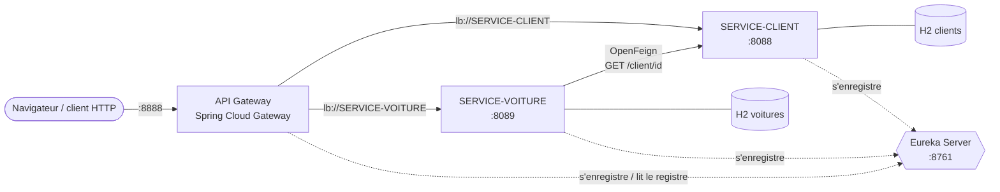
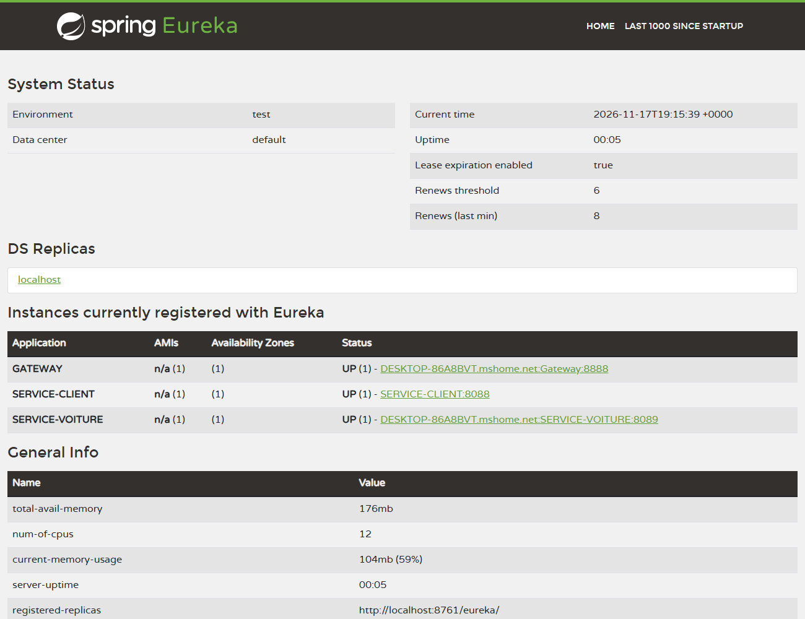
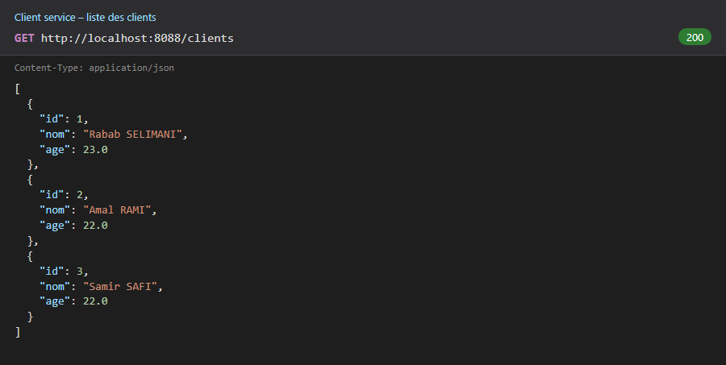
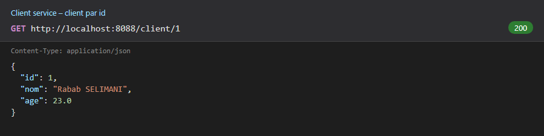
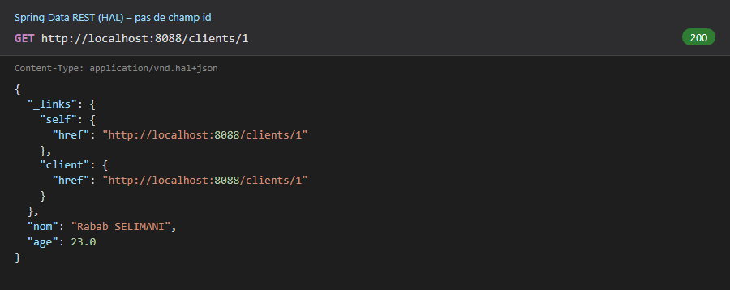
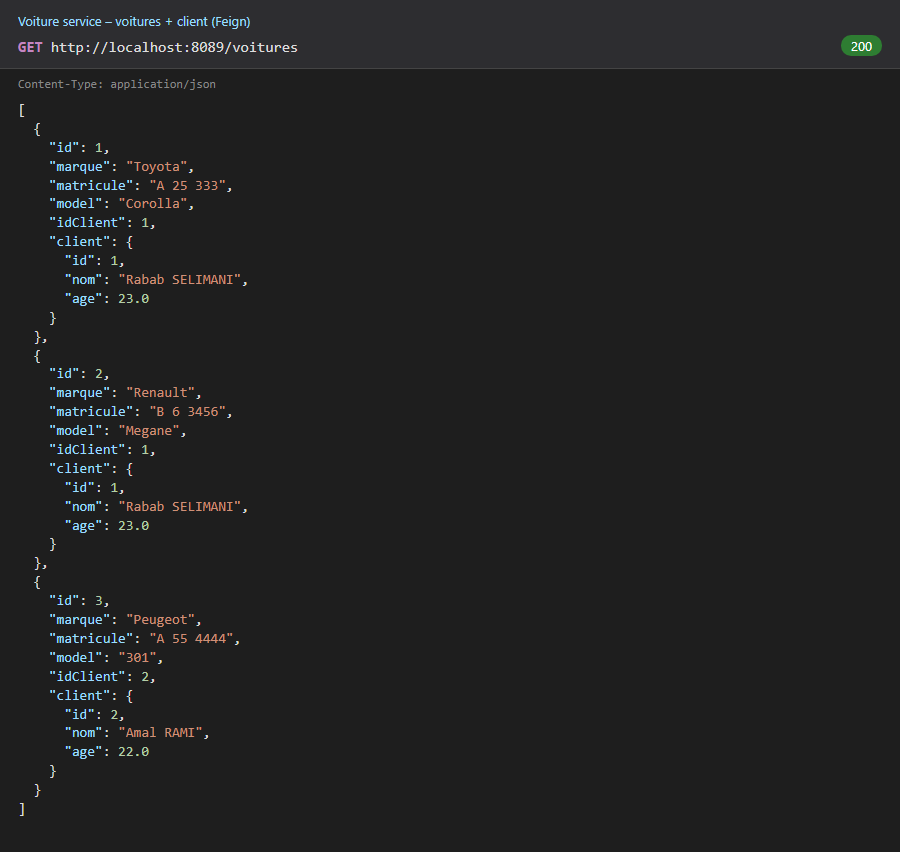
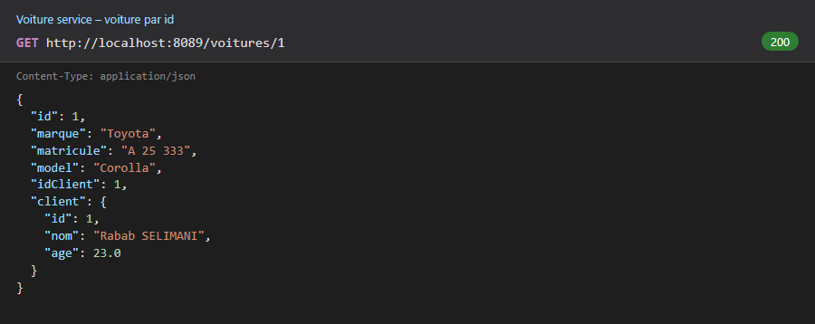
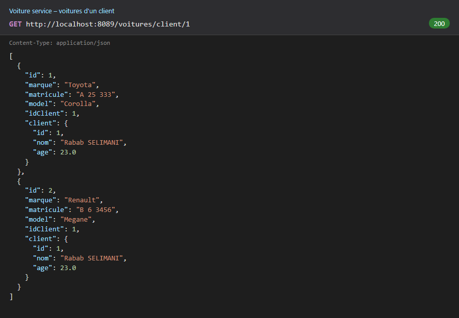
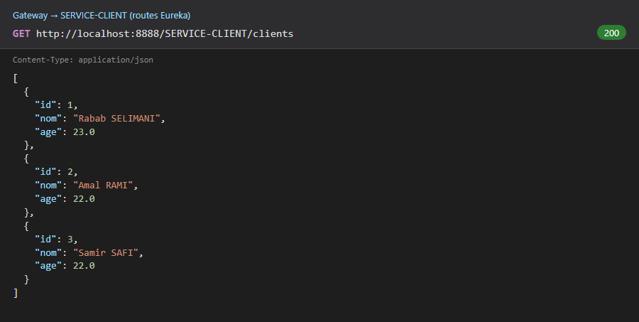
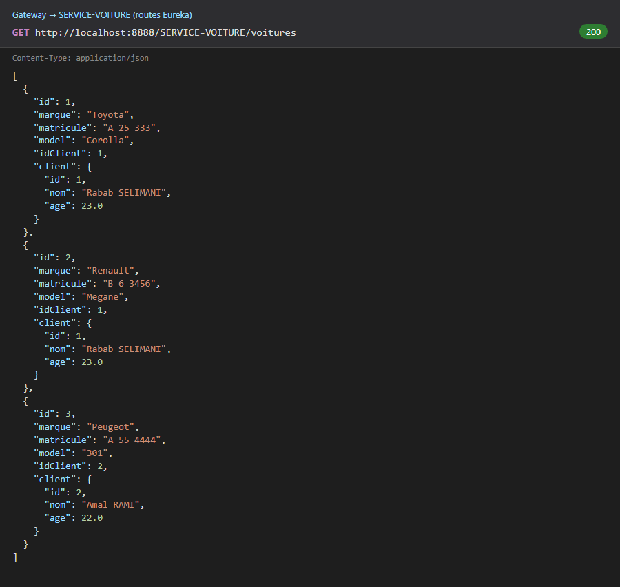

# TP19 – Architecture micro-services avec Spring Cloud (Eureka, Gateway, OpenFeign)

Dans ce TP, j'ai construit une petite application en **micro-services** avec **Spring Boot 4** et **Spring Cloud 2025.1**.
Deux services métier, **Client** et **Voiture**, ont chacun leur propre base H2. Ils s'enregistrent auprès d'un annuaire **Eureka**
et communiquent entre eux avec **OpenFeign**. Une **API Gateway** sert de point d'entrée unique et trouve les services grâce à Eureka.

---

## Sommaire

1. [Objectifs](#1-objectifs)
2. [Architecture](#2-architecture)
3. [Technologies utilisées](#3-technologies-utilisées)
4. [Structure du projet](#4-structure-du-projet)
5. [Explication du code](#5-explication-du-code)
6. [Endpoints](#6-endpoints)
7. [Lancer le projet](#7-lancer-le-projet)
8. [Tests et captures d'écran](#8-tests-et-captures-décran)
9. [Problèmes rencontrés](#9-problèmes-rencontrés)
10. [Conclusion](#10-conclusion)

---

## 1. Objectifs

- Mettre en place un **serveur de découverte** (Eureka Server) où chaque service s'enregistre.
- Créer deux micro-services indépendants (**Client** et **Voiture**), chacun avec sa propre base de données.
- Faire communiquer les services avec **OpenFeign**, sans écrire d'URL en dur : on utilise le **nom** du service dans Eureka.
- Exposer tous les services derrière une **API Gateway** (Spring Cloud Gateway) avec des routes créées automatiquement à partir d'Eureka.
- Comprendre pourquoi on **ne peut pas** faire de relation JPA (`@ManyToOne`) entre deux micro-services.

## 2. Architecture



| Service | Port | Nom dans Eureka | Rôle |
|---------|------|-----------------|------|
| Eureka Server | 8761 | – | Annuaire des services |
| Client | 8088 | `SERVICE-CLIENT` | Gestion des clients |
| service-voiture | 8089 | `SERVICE-VOITURE` | Gestion des voitures + appel du service Client |
| GateWay | 8888 | `GATEWAY` | Point d'entrée unique, routage vers les services |

Chaque service est un **projet Maven indépendant**, avec son propre `pom.xml` et son propre `mvnw`.

## 3. Technologies utilisées

| Outil | Version | Rôle |
|-------|---------|------|
| Java | 21 (compilé avec un JDK 25) | Langage |
| Spring Boot | 4.1.2 | Framework principal |
| Spring Cloud | 2025.1.4 | Outils micro-services |
| Spring Cloud Netflix Eureka | – | Serveur et clients de découverte |
| Spring Cloud Gateway (WebFlux) | – | API Gateway réactive |
| Spring Cloud OpenFeign | – | Client HTTP déclaratif entre services |
| Spring Data JPA + Hibernate | 7.x | Accès aux données |
| Spring Data REST | – | Exposition automatique du repository Client |
| H2 | 2.x | Base de données en mémoire |
| Lombok | – | Getters, setters et constructeurs générés |

## 4. Structure du projet

```
tp19/
├── Eureka Server/
│   └── src/main/
│       ├── java/ma/eureka_server/EurekaServerApplication.java
│       └── resources/application.properties
├── Client/
│   └── src/main/
│       ├── java/ma/client/
│       │   ├── ClientApplication.java          # + données de départ
│       │   ├── controllers/ClientController.java
│       │   ├── entities/Client.java            # @Entity
│       │   └── repositories/ClientRepository.java
│       └── resources/application.properties
├── service-voiture/
│   └── src/main/
│       ├── java/ma/servicevoiture/
│       │   ├── ServiceVoitureApplication.java  # @EnableFeignClients + données de départ
│       │   ├── controllers/VoitureController.java
│       │   ├── entities/
│       │   │   ├── Voiture.java                # @Entity
│       │   │   └── Client.java                 # simple DTO (pas une entité)
│       │   ├── repositories/VoitureRepository.java
│       │   └── services/ClientService.java     # interface @FeignClient
│       └── resources/application.properties
├── GateWay/
│   └── src/main/
│       ├── java/ma/gateway/GateWayApplication.java  # routes dynamiques via Eureka
│       └── resources/application.properties
└── screenshots/
```

## 5. Explication du code

### 5.1 Eureka Server

Une seule annotation transforme une application Spring Boot en annuaire de services :

```java
@EnableEurekaServer
@SpringBootApplication
public class EurekaServerApplication { ... }
```

```properties
server.port=8761
eureka.client.register-with-eureka=false
eureka.client.fetch-registry=false
```

Le serveur ne doit pas s'enregistrer **lui-même** comme client, d'où les deux propriétés à `false`.

### 5.2 Service Client

Une entité JPA classique, un `JpaRepository` et un contrôleur REST :

```java
@Entity @Data @AllArgsConstructor @NoArgsConstructor
public class Client {
    @Id @GeneratedValue
    private Long id;
    private String nom;
    private Float age;
}
```

```java
@GetMapping("/clients")       // liste
@GetMapping("/client/{id}")   // un client (utilisé par Feign)
```

Trois clients sont insérés au démarrage avec un `CommandLineRunner` (`id = null` : c'est la base qui génère l'identifiant).

```properties
server.port=8088
spring.application.name=SERVICE-CLIENT
eureka.client.service-url.defaultZone=http://localhost:8761/eureka/
```

C'est `spring.application.name` qui donne le **nom** du service dans Eureka. Les autres services l'utilisent pour le trouver.

### 5.3 Service Voiture

**L'entité `Voiture`** ne contient que l'**identifiant** du client, pas une relation JPA :

```java
@Entity @Data @AllArgsConstructor @NoArgsConstructor
public class Voiture {
    @Id @GeneratedValue
    private Long id;
    private String marque;
    private String matricule;
    private String model;
    private Long idClient;      // stocké en base (colonne id_client)

    @Transient
    private Client client;      // pas en base : rempli via Feign
}
```

Les clients sont stockés dans **une autre base**, celle du service Client. Hibernate ne peut donc pas faire de jointure,
et `@ManyToOne` est impossible ici. On garde seulement `idClient`, puis on va chercher le client complet **par HTTP**.
`Client` est ici un simple **DTO** (pas d'`@Entity`) qui reçoit le JSON renvoyé par le service Client.

**Le client Feign** : on déclare seulement une interface, et Spring Cloud génère l'implémentation.

```java
@FeignClient(name = "SERVICE-CLIENT")
public interface ClientService {
    @GetMapping("/client/{id}")
    Client clientById(@PathVariable Long id);
}
```

`name = "SERVICE-CLIENT"` est le nom du service dans Eureka. Feign demande à Eureka où se trouve ce service, puis fait l'appel.
Il n'y a aucune adresse `localhost:8088` dans le code. Pour activer Feign, il faut `@EnableFeignClients` sur la classe principale.

**Le contrôleur** combine les données des deux services :

```java
@GetMapping("/voitures")
public ResponseEntity<Object> findAll() {
    List<Voiture> voitures = voitureRepository.findAll();
    for (Voiture v : voitures) {
        v.setClient(clientService.clientById(v.getIdClient()));
    }
    return ResponseEntity.ok(voitures);
}
```

Le repository utilise une **requête dérivée** : Spring Data écrit lui-même la requête à partir du nom de la méthode.

```java
List<Voiture> findByIdClient(Long idClient);
```

### 5.4 API Gateway

La Gateway utilise la version **réactive** (WebFlux) de Spring Cloud Gateway et crée ses routes **automatiquement** à partir d'Eureka :

```java
@Bean
DiscoveryClientRouteDefinitionLocator routesDynamique(
        ReactiveDiscoveryClient rdc, DiscoveryLocatorProperties dlp) {
    return new DiscoveryClientRouteDefinitionLocator(rdc, dlp);
}
```

Pour chaque service enregistré, une route `/<NOM-DU-SERVICE>/**` est créée. Elle retire le préfixe et transmet la requête au service
avec équilibrage de charge (`lb://`). Par exemple :

```
http://localhost:8888/SERVICE-VOITURE/voitures  →  SERVICE-VOITURE  /voitures
```

Ainsi, un nouveau service est accessible par la Gateway dès qu'il s'enregistre dans Eureka, sans modifier la configuration.

## 6. Endpoints

### Service Client (`:8088`)

| Méthode | URL | Description |
|---------|-----|-------------|
| GET | `/clients` | Liste des clients |
| GET | `/client/{id}` | Un client par id |
| GET | `/clients/{id}` | Même client, exposé par Spring Data REST (format HAL) |

### Service Voiture (`:8089`)

| Méthode | URL | Description |
|---------|-----|-------------|
| GET | `/voitures` | Toutes les voitures, avec leur client |
| GET | `/voitures/{id}` | Une voiture, avec son client |
| GET | `/voitures/client/{id}` | Les voitures d'un client |
| POST | `/voitures/{clientId}` | Ajouter une voiture pour un client (corps JSON) |
| PUT | `/voitures/{id}` | Modifier marque, matricule ou modèle |

### Via la Gateway (`:8888`)

| URL | Redirigée vers |
|-----|----------------|
| `/SERVICE-CLIENT/clients` | `SERVICE-CLIENT /clients` |
| `/SERVICE-CLIENT/client/1` | `SERVICE-CLIENT /client/1` |
| `/SERVICE-VOITURE/voitures` | `SERVICE-VOITURE /voitures` |
| `/SERVICE-VOITURE/voitures/client/1` | `SERVICE-VOITURE /voitures/client/1` |

Exemple d'ajout d'une voiture :

```bash
curl -X POST http://localhost:8089/voitures/3 -H "Content-Type: application/json" -d "{\"marque\":\"Dacia\",\"matricule\":\"C 12 7788\",\"model\":\"Logan\"}"
```

## 7. Lancer le projet

Prérequis : un JDK 21 ou plus récent. Maven n'est pas nécessaire, car chaque projet contient le wrapper `mvnw`.

L'**ordre** compte. Lancez chaque service dans un terminal séparé :

```bash
cd "Eureka Server" && ./mvnw spring-boot:run
```

```bash
cd Client && ./mvnw spring-boot:run
```

```bash
cd service-voiture && ./mvnw spring-boot:run
```

```bash
cd GateWay && ./mvnw spring-boot:run
```

1. **Eureka** d'abord : les autres services s'y enregistrent.
2. **Client** ensuite, et attendre qu'il apparaisse sur `http://localhost:8761`.
3. **Voiture** : au démarrage, il appelle déjà le service Client par Feign pour remplir ses données. Si Client n'est pas encore enregistré, on obtient l'erreur `Load balancer does not contain an instance for the service SERVICE-CLIENT`.
4. **Gateway** en dernier. Ses routes dynamiques apparaissent après la lecture du registre Eureka, ce qui prend quelques secondes.

## 8. Tests et captures d'écran

### 8.1 Tableau de bord Eureka

Les trois services sont enregistrés et `UP` : `GATEWAY`, `SERVICE-CLIENT` et `SERVICE-VOITURE`.



### 8.2 Service Client





La même ressource exposée par **Spring Data REST** est au format **HAL** : le champ `id` n'apparaît pas,
il est seulement dans le lien `_links.self`. C'est pour cela que le client Feign appelle `/client/{id}` et non `/clients/{id}` (voir 9.6).



### 8.3 Service Voiture (avec appel Feign)

Chaque voiture contient l'objet `client` complet, récupéré à partir du service Client :







### 8.4 Accès par la Gateway

Les mêmes données, mais par le port **8888** et avec le nom du service dans l'URL :





## 9. Problèmes rencontrés

### 9.1 Gateway : la route YAML était ignorée (404)

La configuration utilisait `spring.cloud.gateway.routes`, comme dans les anciens tutoriels.
Depuis **Spring Cloud 2025**, les propriétés ont changé de nom selon la version de la Gateway :

| Starter | Préfixe des routes |
|---------|--------------------|
| `spring-cloud-starter-gateway-server-webflux` | `spring.cloud.gateway.server.webflux.routes` |
| `spring-cloud-starter-gateway-server-webmvc` | `spring.cloud.gateway.server.webmvc.routes` |

Spring ne signale pas une propriété inconnue : la Gateway démarrait donc **sans aucune route** et répondait 404.
L'ancien starter `spring-cloud-starter-gateway` a lui aussi été renommé.

### 9.2 Indentation YAML

`webmvc:` était écrit au même niveau que `server:` au lieu d'être indenté en dessous. Le chemin devenait alors
`spring.cloud.gateway.webmvc.routes`, toujours un mauvais préfixe. En YAML, **seule l'indentation** définit l'imbrication.

### 9.3 Deux `Path` = ET, pas OU

```yaml
predicates:
  - Path=/clients/**
  - Path=/client/**
```

Chaque ligne de `predicates` est une condition, et **toutes** doivent être vraies. Aucune URL ne peut commencer à la fois par `/clients` et par `/client/`,
donc la route ne correspondait plus à rien. **Solution :** un seul `Path` avec plusieurs motifs séparés par des virgules (OU) :
`Path=/clients/**, /client/*`.

### 9.4 Bean de routes dynamiques avec le mauvais starter

`DiscoveryClientRouteDefinitionLocator` et `ReactiveDiscoveryClient` appartiennent à la Gateway **réactive** (WebFlux).
Avec le starter `webmvc`, ces classes n'existent pas et le projet ne compilait pas.
**Solution :** passer au starter `spring-cloud-starter-gateway-server-webflux`.

### 9.5 `@ManyToOne` vers `Client` dans `Voiture`

Hibernate refusait de démarrer, car `Client` n'est pas une entité dans le service Voiture.
En micro-services, **chaque service a sa propre base** : on ne peut pas faire de jointure entre deux services.
**Solution :** garder `idClient` en base, marquer `client` comme `@Transient` seulement, et le remplir avec Feign.

### 9.6 Feign : bean introuvable, puis mauvais chemin

- Sans `@EnableFeignClients`, Spring ne crée pas l'implémentation de `ClientService`. On obtient `No qualifying bean of type 'ClientService'`.
- Feign appelait `/clients/{id}`. Cette URL est servie par **Spring Data REST** en HAL, **sans** le champ `id`, donc `client.getId()` valait `null`.
  **Solution :** appeler `/client/{id}`, l'endpoint du contrôleur, qui renvoie du JSON simple.

### 9.7 Identifiant forcé avec `@GeneratedValue`

Les voitures de départ étaient créées avec des id `1`, `2` et `3`. Avec un id non nul, `save()` fait un `merge`, et depuis
Hibernate 6.6, faire un `merge` sur une ligne qui n'existe pas lève une exception de verrouillage optimiste.
**Solution :** passer `null` et laisser la base générer l'id.

### 9.8 `GET /voitures` renvoyait 404

Un `JpaRepository` n'expose **aucune URL** : il ne parle qu'à la base de données. La dépendance `hateoas` ne crée pas d'endpoints non plus,
contrairement à Spring Data REST. **Solution :** écrire un `@RestController`. Ce contrôleur permet aussi de remplir le champ `client` avec Feign.

### 9.9 Code copié avec des balises HTML et des noms différents

Le contrôleur copié depuis l'énoncé contenait des balises `<i><em>…</em></i>` autour des commentaires, une classe `VoitureService` absente
et des méthodes `getClientId()` / `findByClientId()`. **Solution :** utiliser directement le repository, renommer le champ `IdClient` en `idClient`
(convention Java, nécessaire pour la requête dérivée `findByIdClient`) et importer le bon `ClientService`.

### 9.10 Nom du fichier de configuration de la Gateway

Spring Boot charge seulement `application.yml` / `application.properties`. Le fichier `GateWay/src/main/resources/app.yml` n'est donc **pas lu**.
Les routes statiques qu'il contient (`/clients/**`, `/client/*`) ne sont pas actives : `http://localhost:8888/clients` renvoie 404.
Tout le routage passe actuellement par les **routes dynamiques** Eureka (`/SERVICE-CLIENT/...`).
Pour activer aussi les routes statiques, il suffit de renommer le fichier en `application.yml`.

## 10. Conclusion

Ce TP m'a montré les briques de base d'une architecture micro-services :

- **Eureka** évite d'écrire les adresses des services en dur : chaque service est trouvé par son **nom**.
- **OpenFeign** rend un appel HTTP entre services aussi simple qu'un appel de méthode Java.
- La **Gateway** donne un point d'entrée unique, et avec le *discovery locator*, les routes suivent automatiquement les services enregistrés.
- Chaque service garde **sa propre base**. Les relations entre services passent par des **identifiants** et des appels HTTP, pas par JPA.

J'ai aussi appris que Spring Cloud évolue vite : le nom des starters, le préfixe des propriétés et la version de Spring Boot vont ensemble.
Il faut vérifier les versions d'un tutoriel avant de le copier.

Pistes d'amélioration :
- ajouter un **circuit breaker** (Resilience4j) pour que le service Voiture réponde même si le service Client est arrêté ;
- renvoyer **404** au lieu de **500** quand un client n'existe pas (`ResponseStatusException`) ;
- centraliser la configuration avec **Spring Cloud Config** ;
- éviter un appel Feign par voiture dans `/voitures` en récupérant les clients en une seule requête.

---

**Auteur :** Mouad Handaji – Module Micro-services
