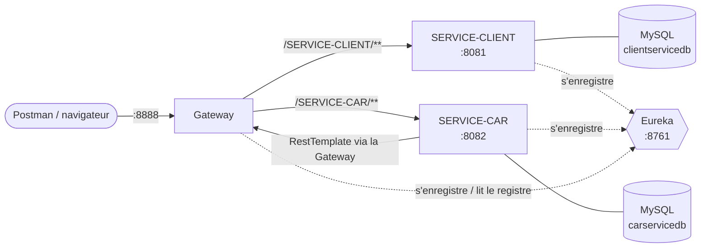
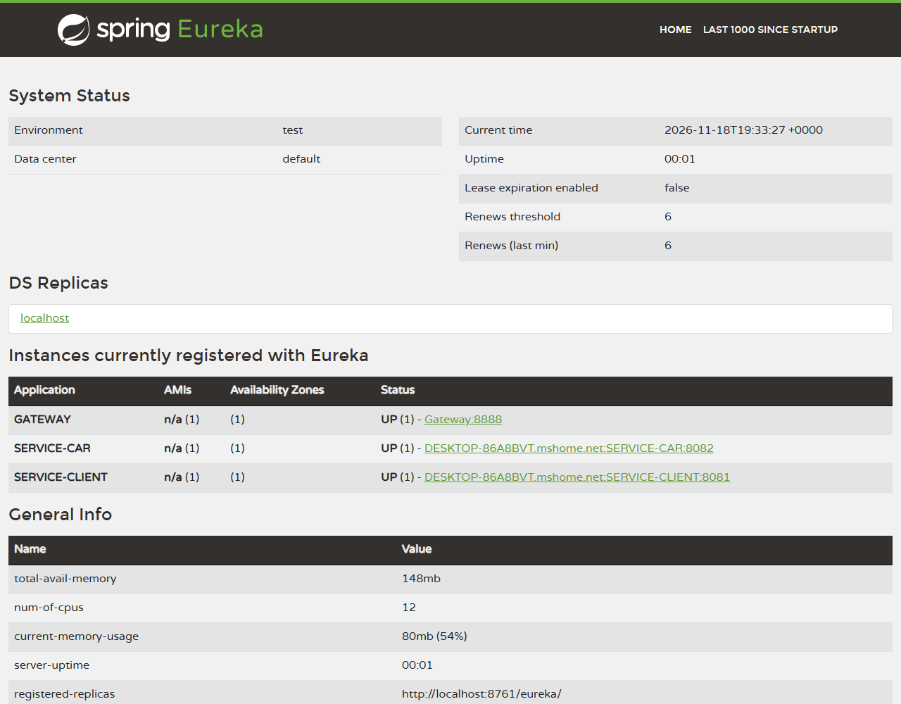
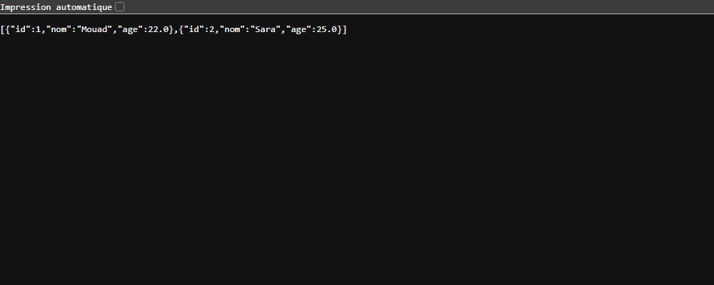
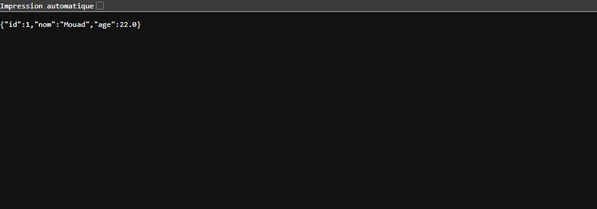
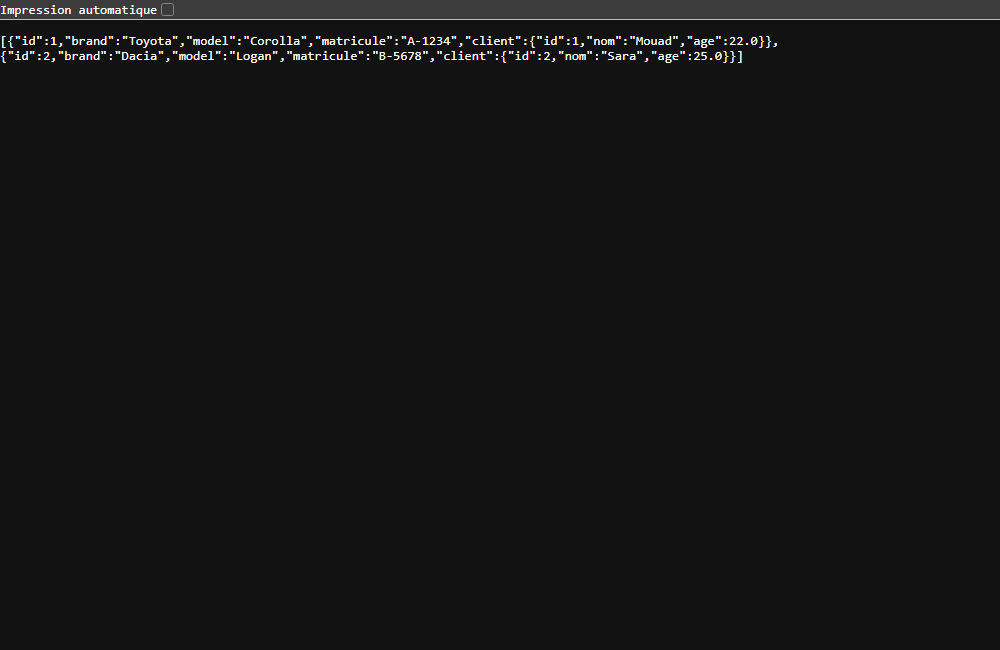
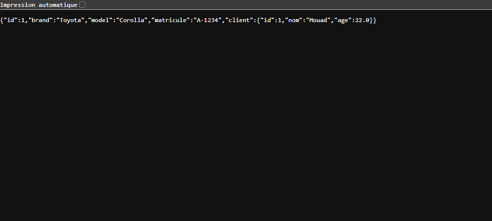
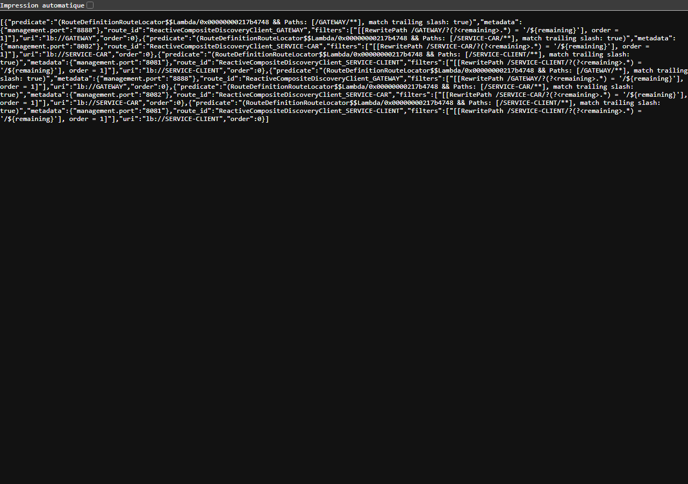

# TP20 – Architecture micro-services avec RestTemplate

Dans ce TP, j'ai construit une application en **micro-services** avec **Spring Boot 4** et **Spring Cloud 2025.1**.
Il y a deux services métier : **Client** et **Voiture (Car)**. Chacun a sa propre base **MySQL**.
Ils s'enregistrent auprès d'un annuaire **Eureka**, et une **API Gateway** sert de point d'entrée unique.
Le service Voiture récupère les informations du propriétaire en appelant le service Client avec **RestTemplate**.

---

## Sommaire

1. [Objectifs](#1-objectifs)
2. [Architecture](#2-architecture)
3. [Technologies utilisées](#3-technologies-utilisées)
4. [Structure du projet](#4-structure-du-projet)
5. [Partie A – Eureka Server](#5-partie-a--eureka-server)
6. [Partie B – Microservice Client](#6-partie-b--microservice-client)
7. [Partie C – Gateway](#7-partie-c--gateway)
8. [Partie D – Microservice Voiture](#8-partie-d--microservice-voiture)
9. [Endpoints](#9-endpoints)
10. [Lancer le projet](#10-lancer-le-projet)
11. [Tests](#11-tests)
12. [Problèmes rencontrés](#12-problèmes-rencontrés)
13. [Notions à retenir](#13-notions-à-retenir)
14. [Conclusion](#14-conclusion)

---

## 1. Objectifs

- Mettre en place un **serveur de découverte** (Eureka) où les services s'enregistrent.
- Créer un micro-service **Client** avec une architecture en couches (entity, repository, service, controller).
- Mettre en place une **Gateway** qui crée ses routes **automatiquement** à partir d'Eureka.
- Créer un micro-service **Voiture** qui appelle le service Client avec **RestTemplate**.
- Utiliser **une base de données par service** (`clientservicedb` et `carservicedb`).

## 2. Architecture



| Service | Port | Nom dans Eureka | Rôle |
|---------|------|-----------------|------|
| eureka-server | 8761 | – | Annuaire des services |
| client-service | 8081 | `SERVICE-CLIENT` | Gestion des clients |
| gateway | 8888 | `GATEWAY` | Point d'entrée unique, routage dynamique |
| car-service | 8082 | `SERVICE-CAR` | Gestion des voitures + appel du service Client |

Chaque service est un **projet Maven indépendant**, avec son propre `pom.xml` et son propre `mvnw`.

## 3. Technologies utilisées

| Outil | Version | Rôle |
|-------|---------|------|
| Java | 21 | Langage |
| Spring Boot | 4.1.2 | Framework |
| Spring Cloud | 2025.1.4 | Eureka, Gateway |
| Spring Data JPA / Hibernate | (Boot) | Accès aux données |
| MySQL (XAMPP) | 3306 | Base de données |
| Lombok | (Boot) | Génère getters/setters/constructeurs |
| RestTemplate | (Spring Web) | Appels HTTP entre services |

## 4. Structure du projet

```
tp20/
├── eureka-server/
│   └── src/main/
│       ├── java/com/example/eurekaserver/EurekaServerApplication.java
│       └── resources/application.yml
├── client-service/
│   └── src/main/
│       ├── java/com/example/client/
│       │   ├── ClientServiceApplication.java
│       │   ├── entities/Client.java
│       │   ├── repositories/ClientRepository.java
│       │   ├── services/ClientService.java
│       │   └── controllers/ClientController.java
│       └── resources/application.yml
├── gateway/
│   └── src/main/
│       ├── java/com/example/gateway/GatewayApplication.java
│       └── resources/application.yml
└── car-service/
    └── src/main/
        ├── java/com/example/car/
        │   ├── CarApplication.java          (bean RestTemplate)
        │   ├── entities/Car.java
        │   ├── models/Client.java           (DTO)
        │   ├── models/CarResponse.java      (voiture + client)
        │   ├── repositories/CarRepository.java
        │   ├── services/CarService.java
        │   └── controllers/CarController.java
        └── resources/application.yml
```

## 5. Partie A – Eureka Server

Eureka est un **annuaire** : chaque service y déclare son nom, son adresse IP et son port.
Les autres services demandent ensuite à Eureka « où est SERVICE-CLIENT ? » au lieu d'écrire l'adresse en dur.

- Dépendance : `spring-cloud-starter-netflix-eureka-server`.
- `@EnableEurekaServer` sur la classe principale transforme l'application en serveur Eureka.
- Dans `application.yml` :
  - `server.port: 8761` : port utilisé par convention pour Eureka.
  - `register-with-eureka: false` et `fetch-registry: false` : le serveur ne s'enregistre pas chez lui-même (c'est lui l'annuaire).
  - Les logs `com.netflix.*` sont mis à `OFF` pour avoir une console plus lisible.

Le tableau de bord est sur **http://localhost:8761**. Au début, il affiche « No instances available ». C'est normal.

## 6. Partie B – Microservice Client

Architecture en couches classique :

| Couche | Classe | Rôle |
|--------|--------|------|
| Entity | `Client` | Table `client` (id, nom, age) |
| Repository | `ClientRepository` | Hérite de `JpaRepository<Client, Long>` → `findAll`, `findById`, `save`… sans rien écrire |
| Service | `ClientService` | Logique métier, lance une exception si le client n'existe pas |
| Controller | `ClientController` | Expose l'API REST `/api/client` |

Points importants :

- `@Entity`, `@Id`, `@GeneratedValue(strategy = IDENTITY)` : l'id est auto-incrémenté par MySQL.
- Lombok : `@Data` génère les getters/setters, `toString`, `equals` et `hashCode`. `@NoArgsConstructor` et `@AllArgsConstructor` génèrent les constructeurs.
- `findById` renvoie un `Optional`. On utilise `orElseThrow()` pour gérer le cas « pas trouvé ».
- Dans le controller, `ResponseEntity` permet de choisir le code HTTP : **200**, **201 Created** pour le POST et **404** si le client n'existe pas.
- `spring.application.name: SERVICE-CLIENT` : c'est le **nom affiché dans Eureka**, et il est aussi utilisé dans l'URL de la Gateway.
- `createDatabaseIfNotExist=true` dans l'URL JDBC : MySQL crée la base automatiquement.
- `ddl-auto: update` : Hibernate crée ou met à jour les tables tout seul.
- `@EnableDiscoveryClient` : le service s'enregistre auprès d'Eureka (`defaultZone: http://localhost:8761/eureka/`).

## 7. Partie C – Gateway

La Gateway est la **porte d'entrée unique** : le client appelle seulement le port `8888`, et la Gateway transfère la requête au bon service.

- Dépendances : `spring-cloud-starter-gateway-server-webflux` + `eureka-client` + `actuator`.
- `discovery.locator.enabled: true` : une **route est créée automatiquement** pour chaque service enregistré dans Eureka.
- Le bean `DiscoveryClientRouteDefinitionLocator` utilise le `ReactiveDiscoveryClient` pour lire Eureka et produire ces routes.
- `lower-case-service-id: false` : on garde les noms en majuscules dans l'URL (`/SERVICE-CLIENT/...`).
- Actuator expose `/actuator/health`, `/actuator/info` et `/actuator/gateway` (pour voir les routes).

**Ce qui se passe pour `GET http://localhost:8888/SERVICE-CLIENT/api/client` :**

1. La requête arrive sur la Gateway (port 8888).
2. La Gateway lit le nom du service dans l'URL : `SERVICE-CLIENT`.
3. Elle demande à Eureka l'adresse de ce service.
4. Elle retire le préfixe et envoie la requête à `http://<ip>:8081/api/client`.
5. Elle renvoie la réponse au client.

## 8. Partie D – Microservice Voiture

- Entité `Car` : id, brand, model, matricule, **client_id**.
- **Pas de `@ManyToOne` vers Client** : le client est dans une autre base et un autre service. On garde seulement son **id**, puis on va chercher le client par HTTP.
- `models/Client` : simple classe **DTO**, pas une entité. Elle sert juste à recevoir le JSON envoyé par le service Client.
- `CarResponse` (avec `@Builder`) : la réponse finale, qui contient la voiture **et l'objet client complet**.
- Le bean `RestTemplate` est déclaré dans `CarApplication`, avec des **timeouts de 5 s** (connexion + lecture). Sans timeout, un service en panne pourrait bloquer l'appel.
- `CarService.mapToCarResponse()` :
  ```java
  client = restTemplate.getForObject(URL + car.getClient_id(), Client.class);
  ```
  `getForObject` fait un `GET` et convertit le JSON reçu en objet `Client`.
  L'URL passe par la Gateway : `http://localhost:8888/SERVICE-CLIENT/api/client/{id}`.
- Si le service Client ne répond pas, on attrape l'exception et on renvoie la voiture avec `client: null` au lieu de faire planter toute la requête (début de **résilience**).

## 9. Endpoints

| Méthode | URL directe | URL via Gateway | Description |
|---------|-------------|-----------------|-------------|
| GET | `localhost:8081/api/client` | `localhost:8888/SERVICE-CLIENT/api/client` | Liste des clients |
| GET | `localhost:8081/api/client/{id}` | `localhost:8888/SERVICE-CLIENT/api/client/{id}` | Un client (404 sinon) |
| POST | `localhost:8081/api/client` | `localhost:8888/SERVICE-CLIENT/api/client` | Ajouter un client (201) |
| GET | `localhost:8082/api/car` | `localhost:8888/SERVICE-CAR/api/car` | Voitures + leur client |
| GET | `localhost:8082/api/car/{id}` | `localhost:8888/SERVICE-CAR/api/car/{id}` | Une voiture + son client |
| GET | – | `localhost:8888/actuator/gateway/routes` | Routes créées par la Gateway |

## 10. Lancer le projet

**Prérequis :** JDK 21+ et MySQL sur le port 3306 (utilisateur `root` sans mot de passe, par exemple XAMPP).

Ordre de démarrage (chaque commande dans un terminal séparé) :

```bash
cd eureka-server && ./mvnw spring-boot:run
```
```bash
cd client-service && ./mvnw spring-boot:run
```
```bash
cd gateway && ./mvnw spring-boot:run
```
```bash
cd car-service && ./mvnw spring-boot:run
```

Il faut toujours démarrer **Eureka en premier**. Après le démarrage, il faut attendre environ 30 secondes : la Gateway rafraîchit sa liste de services périodiquement.

## 11. Tests

Ajouter des clients :

```bash
curl -X POST localhost:8888/SERVICE-CLIENT/api/client -H "Content-Type: application/json" -d '{"nom":"Mouad","age":22}'
```

Ajouter des voitures (il n'y a pas de POST dans ce service, donc on passe par MySQL ou phpMyAdmin) :

```sql
USE carservicedb;
INSERT INTO car(brand, model, matricule, client_id) VALUES
('Toyota', 'Corolla', 'A-1234', 1),
('Dacia', 'Logan', 'B-5678', 2);
```

Résultat obtenu avec `GET http://localhost:8888/SERVICE-CAR/api/car` :

```json
[
  {"id":1,"brand":"Toyota","model":"Corolla","matricule":"A-1234","client":{"id":1,"nom":"Mouad","age":22.0}},
  {"id":2,"brand":"Dacia","model":"Logan","matricule":"B-5678","client":{"id":2,"nom":"Sara","age":25.0}}
]
```

`GET http://localhost:8082/api/car/9` renvoie **404** avec le message `Voiture introuvable, id = 9`.

### Captures d'écran

**1. Tableau de bord Eureka** (http://localhost:8761) : les 3 instances `GATEWAY`, `SERVICE-CAR` et `SERVICE-CLIENT` sont `UP`.



**2. Liste des clients en appel direct** : `GET http://localhost:8081/api/client`


**3. Liste des clients via la Gateway** : `GET http://localhost:8888/SERVICE-CLIENT/api/client` (même résultat, mais sur le port 8888)



**4. Un client par id via la Gateway** : `GET http://localhost:8888/SERVICE-CLIENT/api/client/1`



**5. Voitures avec leur client via la Gateway** : `GET http://localhost:8888/SERVICE-CAR/api/car`. L'objet `client` est récupéré avec RestTemplate.



**6. Une voiture par id** : `GET http://localhost:8082/api/car/1`



**7. Voiture inexistante** : `GET http://localhost:8082/api/car/9` renvoie 404.


**8. Routes créées automatiquement par la Gateway** : `GET http://localhost:8888/actuator/gateway/routes`. On voit une route `lb://SERVICE-...` par service, avec le filtre `RewritePath` qui retire le nom du service de l'URL.



## 12. Problèmes rencontrés

| Problème | Cause | Solution |
|----------|-------|----------|
| Le nom du client était `null` dans la réponse voiture | Le DTO `Client` du service voiture utilisait `name` / `Integer` alors que l'entité du service Client a `nom` / `Float` | Utiliser les **mêmes noms de champs** que le JSON reçu (`nom`, `age`) |
| La Gateway ne démarre pas avec `spring-boot-starter-web` | Gateway est basée sur **WebFlux** (réactif), incompatible avec Spring MVC | Ne pas mettre `starter-web` dans la Gateway |
| Les routes automatiques ne marchent pas avec `spring.cloud.gateway.discovery...` | Dans Spring Cloud 2025, les propriétés ont été déplacées | Utiliser `spring.cloud.gateway.server.webflux.discovery.locator.enabled` |
| `@EnableEurekaClient` introuvable | Annotation supprimée dans les versions récentes | Utiliser `@EnableDiscoveryClient` (ou rien, le starter suffit) |
| `/actuator/gateway/routes` renvoie 404 | L'endpoint `gateway` d'Actuator est désactivé par défaut | Ajouter `management.endpoint.gateway.access: unrestricted` |
| 404 / 503 via la Gateway juste après le démarrage | La Gateway n'a pas encore reçu le registre d'Eureka | Attendre ~30 s |

## 13. Notions à retenir

- **Micro-service** : petite application indépendante, avec **sa propre base**, déployable seule.
- **Service discovery** : on ne code pas les adresses en dur ; on demande à Eureka où se trouve un service à partir de son nom.
- **API Gateway** : un seul point d'entrée, qui fait le routage (et plus tard : sécurité, logs, rate limiting).
- **RestTemplate** : client HTTP **synchrone** (le thread attend la réponse). Méthodes utiles : `getForObject`, `getForEntity`, `postForObject`, `exchange`.
- **DTO** : objet qui transporte des données entre services ; ce n'est pas une entité JPA.
- **Pas de jointure entre bases** : la relation Voiture → Client se fait par l'**id** + un appel HTTP.
- **Timeouts et gestion d'erreur** : indispensables quand un service dépend d'un autre.
- **RestTemplate vs OpenFeign (TP19)** : avec RestTemplate, on écrit l'URL et l'appel à la main. Avec Feign, on déclare une interface et Spring génère l'appel. WebClient est l'alternative réactive.

## 14. Conclusion

Ce TP m'a permis de monter une architecture micro-services complète : un annuaire **Eureka**, une **Gateway** avec routes dynamiques
et deux services métier (**Client** et **Voiture**), chacun avec sa base MySQL. Ces services communiquent avec **RestTemplate**.

Améliorations possibles : Circuit Breaker avec **Resilience4j**, **Spring Cloud Config** pour centraliser la configuration,
sécurité avec **Spring Security / OAuth2**, traçabilité avec **Zipkin**, et documentation avec **Swagger/OpenAPI**.
