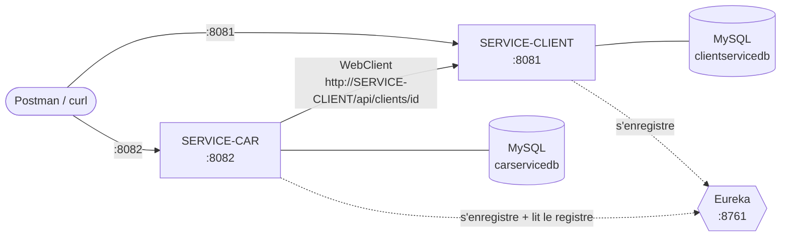
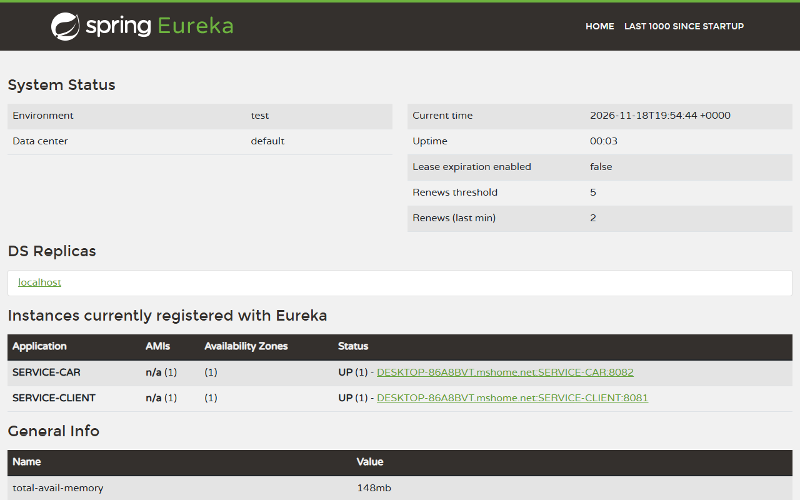
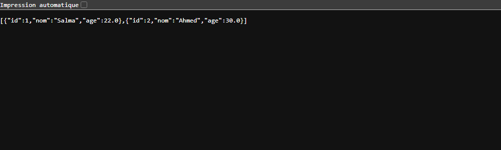
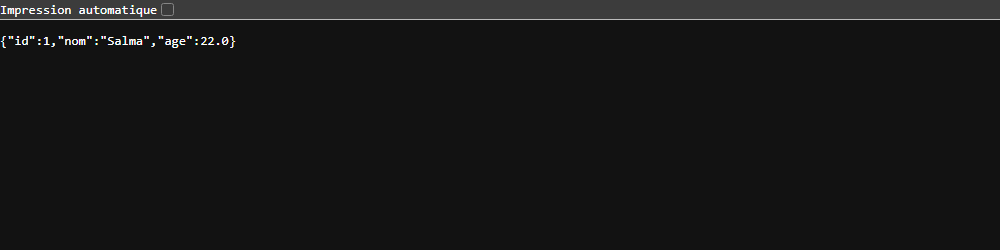
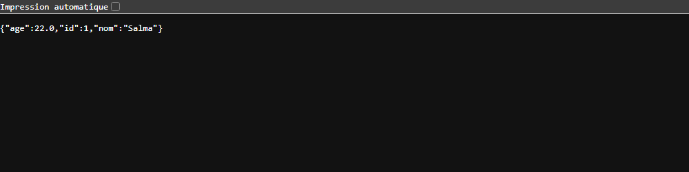
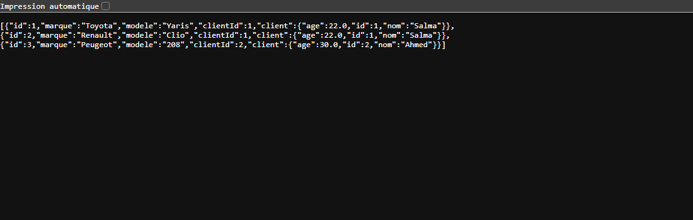
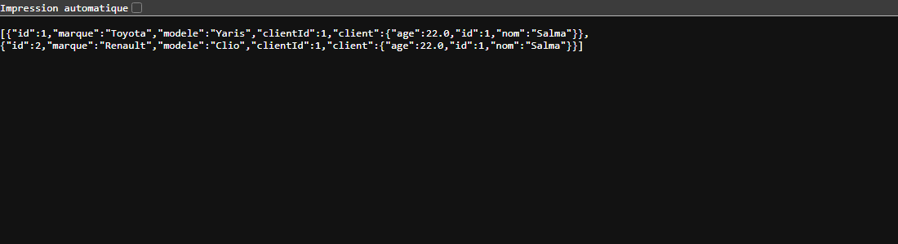

# TP21 – Architecture micro-services avec WebClient

Dans ce TP, j'ai refait l'architecture Client / Voiture du TP20. Cette fois, la communication entre services se fait avec **WebClient**
(Spring WebFlux) au lieu de RestTemplate. Il n'y a pas de Gateway : `service-car` appelle `service-client` directement **par son nom Eureka**
(`http://SERVICE-CLIENT/...`) grâce à **Spring Cloud LoadBalancer** et à l'annotation `@LoadBalanced`.

---

## Sommaire

1. [Objectifs](#1-objectifs)
2. [Architecture](#2-architecture)
3. [Technologies utilisées](#3-technologies-utilisées)
4. [Structure du projet](#4-structure-du-projet)
5. [Étape 1 – Eureka Server](#5-étape-1--eureka-server)
6. [Étape 2 – service-client](#6-étape-2--service-client)
7. [Étape 3 – service-car + WebClient](#7-étape-3--service-car--webclient)
8. [Endpoints](#8-endpoints)
9. [Lancer le projet](#9-lancer-le-projet)
10. [Tests et captures d'écran](#10-tests-et-captures-décran)
11. [Problèmes rencontrés](#11-problèmes-rencontrés)
12. [Notions à retenir](#12-notions-à-retenir)
13. [Conclusion](#13-conclusion)

---

## 1. Objectifs

- Mettre en place **Eureka Server** et y enregistrer deux micro-services (Eureka Client).
- Configurer les services avec `application.yml` (YAML).
- Appeler un service **par son nom Eureka** avec **WebClient**, sans écrire `localhost:8081` dans le code.
- Appliquer le **pattern d'enrichissement** : la voiture est lue dans sa base locale, puis complétée avec les données du client récupérées par HTTP.
- Tester progressivement : dashboard Eureka, puis l'API client, l'endpoint de test WebClient et enfin l'API voitures.

## 2. Architecture



| Service | Port | Nom dans Eureka | Rôle |
|---------|------|-----------------|------|
| eureka-server | 8761 | – | Annuaire des services |
| service-client | 8081 | `SERVICE-CLIENT` | CRUD des clients |
| service-car | 8082 | `SERVICE-CAR` | CRUD des voitures + appel de service-client avec WebClient |

**Comment `http://SERVICE-CLIENT/...` est résolu :**

1. `ClientApi` construit la requête vers `http://SERVICE-CLIENT/api/clients/1`.
2. Grâce à `@LoadBalanced`, le **LoadBalancer** intercepte la requête et voit que `SERVICE-CLIENT` n'est pas un vrai nom d'hôte.
3. Il demande à Eureka la liste des instances de `SERVICE-CLIENT`.
4. Il choisit une instance (round-robin s'il y en a plusieurs) et remplace l'URL par `http://<ip>:8081/api/clients/1`.
5. La requête est envoyée, puis le JSON reçu est converti en objet `Client`.

## 3. Technologies utilisées

| Outil | Version | Rôle |
|-------|---------|------|
| Java | 21 | Langage |
| Spring Boot | 4.1.2 | Framework |
| Spring Cloud | 2025.1.4 | Eureka + LoadBalancer |
| Spring Web (MVC) | (Boot) | API REST |
| Spring WebFlux | (Boot) | Fournit **WebClient** |
| Spring Data JPA / Hibernate | (Boot) | Accès aux données |
| MySQL (XAMPP) | 3306 | Base de données |

Pas de Lombok dans ce TP : les getters, setters et constructeurs sont écrits à la main.

## 4. Structure du projet

```
tp21/
├── eureka-server/
│   └── src/main/
│       ├── java/com/example/eurekaserver/EurekaServerApplication.java
│       └── resources/application.yml
├── service-client/
│   └── src/main/
│       ├── java/com/example/client/
│       │   ├── ServiceClientApplication.java
│       │   ├── entities/Client.java
│       │   ├── repositories/ClientRepository.java
│       │   └── web/ClientController.java
│       └── resources/application.yml
├── service-car/
│   └── src/main/
│       ├── java/com/example/car/
│       │   ├── ServiceCarApplication.java
│       │   ├── config/WebClientConfig.java      (@LoadBalanced WebClient.Builder)
│       │   ├── entities/Car.java                (entité + champ @Transient client)
│       │   ├── entities/Client.java             (DTO, pas une entité)
│       │   ├── repositories/CarRepository.java  (findByClientId)
│       │   ├── services/ClientApi.java          (appel WebClient)
│       │   └── web/
│       │       ├── TestController.java          (test de WebClient seul)
│       │       └── CarController.java
│       └── resources/application.yml
└── screenshots/
```

## 5. Étape 1 – Eureka Server

- Dépendance : `spring-cloud-starter-netflix-eureka-server`.
- `@EnableEurekaServer` active le registre et le dashboard. Sans cette annotation, il n'y a pas de registre.
- `register-with-eureka: false` et `fetch-registry: false` : le serveur **fournit** le registre, il ne s'y inscrit pas lui-même.
- Dashboard : **http://localhost:8761**. Au début, la liste des instances est vide, c'est normal.

## 6. Étape 2 – service-client

- Dépendances : Spring Web, Spring Data JPA, MySQL Driver, Eureka Discovery Client.
- Sans la dépendance Eureka Client, le service n'apparaît pas dans Eureka. Aucune annotation n'est nécessaire, le starter suffit.
- `spring.application.name: SERVICE-CLIENT` : c'est ce nom que WebClient utilisera plus tard dans l'URL.
- **Entité `Client`** : `@Entity`, `@Id` + `IDENTITY` (auto-incrément MySQL). Le **constructeur vide** est obligatoire, car Hibernate crée les objets par réflexion.
- **`ClientRepository`** hérite de `JpaRepository` : on a `findAll()`, `findById()`, `save()` et `deleteById()` sans rien écrire.
- **`ClientController`** (`/api/clients`) utilise l'**injection par constructeur** (champ `final`) au lieu de `@Autowired`. C'est la façon recommandée : le champ ne peut pas être `null` et la classe est facile à tester.
  - `GET /api/clients` → liste
  - `GET /api/clients/{id}` → `findById(id).orElse(null)`
  - `POST /api/clients` → `@RequestBody` transforme le JSON en objet Java, qui est enregistré puis renvoyé en JSON

## 7. Étape 3 – service-car + WebClient

### Dépendances en plus
- **Spring WebFlux** : fournit `WebClient`. L'application reste une application **Spring MVC** classique (Tomcat), car `webmvc` est aussi présent.
- **Spring Cloud LoadBalancer** : il permet de résoudre `http://SERVICE-CLIENT` grâce à Eureka.

### Entités
- `Car` : `marque`, `modele`, `clientId`.
  - `clientId` est un **lien logique** vers le client. Ce n'est pas un `@ManyToOne`, car le client est dans une autre base.
  - `@Transient Client client` : ce champ **n'est pas enregistré** en base. Il sert seulement à renvoyer la voiture avec son client dans le JSON.
- `Client` (côté car) : simple **DTO** sans `@Entity`. Ses champs (`id`, `nom`, `age`) ont les mêmes noms que le JSON de service-client.

### Repository
```java
List<Car> findByClientId(Long clientId);
```
C'est une **méthode dérivée** : Spring Data lit le nom de la méthode et génère `SELECT ... WHERE client_id = ?`.

### WebClientConfig
```java
@Bean
@LoadBalanced
public WebClient.Builder webClientBuilder() {
    return WebClient.builder();
}
```
`@LoadBalanced` ajoute un filtre au builder. Chaque WebClient construit avec ce builder passe par le LoadBalancer.
Sans cette annotation, on obtient l'erreur `Failed to resolve 'SERVICE-CLIENT'` ou `No instances available for SERVICE-CLIENT`.

### ClientApi : l'appel HTTP
```java
return builder.build()
        .get()
        .uri("http://SERVICE-CLIENT/api/clients/" + id)
        .retrieve()
        .bodyToMono(Client.class)
        .block();
```
| Méthode | Rôle |
|---------|------|
| `build()` | crée un WebClient à partir du builder |
| `get()` | requête HTTP GET |
| `uri(...)` | URL **logique**, avec le nom Eureka |
| `retrieve()` | exécute l'appel ; une erreur 4xx/5xx devient une exception |
| `bodyToMono(Client.class)` | la réponse attendue est **un** objet (`Mono`). Pour une liste, on utiliserait `bodyToFlux` |
| `block()` | attend la réponse. C'est bloquant, mais simple pour un TP |

### Controllers
- `TestController` (`/api/test/client/{id}`) : endpoint temporaire pour vérifier **WebClient seul**, avant d'écrire le CarController.
- `CarController` (`/api/cars`) applique le **pattern d'enrichissement** :
  1. il lit les voitures dans `carservicedb` ;
  2. pour chaque voiture, il appelle `clientApi.findClientById(clientId)` ;
  3. il remplit le champ `@Transient client` ;
  4. il renvoie un JSON **agrégé** (voiture + client).

## 8. Endpoints

| Méthode | URL | Description |
|---------|-----|-------------|
| GET | `localhost:8081/api/clients` | Liste des clients |
| GET | `localhost:8081/api/clients/{id}` | Un client |
| POST | `localhost:8081/api/clients` | Ajouter un client |
| GET | `localhost:8082/api/test/client/{id}` | Test : client récupéré par WebClient |
| POST | `localhost:8082/api/cars` | Ajouter une voiture |
| GET | `localhost:8082/api/cars` | Toutes les voitures + leur client |
| GET | `localhost:8082/api/cars/byClient/{clientId}` | Les voitures d'un client |

## 9. Lancer le projet

**Prérequis :** JDK 21+ et MySQL sur le port 3306 (`root` sans mot de passe, par exemple XAMPP).

Ordre de démarrage (un terminal par service) :

```bash
cd eureka-server && ./mvnw spring-boot:run
```
```bash
cd service-client && ./mvnw spring-boot:run
```
```bash
cd service-car && ./mvnw spring-boot:run
```

Après le démarrage, il faut attendre environ 30 secondes : service-car doit d'abord recevoir le registre d'Eureka.

> **Remarque :** ce TP utilise les **mêmes noms de bases** que le TP20 (`clientservicedb`, `carservicedb`), mais la table `car` n'a pas les mêmes colonnes
> (`marque`/`modele` au lieu de `brand`/`model`). Si le TP20 a déjà été lancé, ses voitures apparaissent avec `marque: null`.
> Pour éviter ça, on peut lancer les services sur d'autres bases sans modifier le code :
> ```bash
> ./mvnw spring-boot:run -Dspring-boot.run.arguments=--spring.datasource.url=jdbc:mysql://localhost:3306/carservicedb_tp21?createDatabaseIfNotExist=true
> ```
> J'ai fait mes tests sur `clientservicedb_tp21` et `carservicedb_tp21`.

## 10. Tests et captures d'écran

Scénario complet :

```bash
curl -X POST localhost:8081/api/clients -H "Content-Type: application/json" -d '{"nom":"Salma","age":22}'
curl -X POST localhost:8081/api/clients -H "Content-Type: application/json" -d '{"nom":"Ahmed","age":30}'
curl -X POST localhost:8082/api/cars -H "Content-Type: application/json" -d '{"marque":"Toyota","modele":"Yaris","clientId":1}'
curl -X POST localhost:8082/api/cars -H "Content-Type: application/json" -d '{"marque":"Renault","modele":"Clio","clientId":1}'
curl -X POST localhost:8082/api/cars -H "Content-Type: application/json" -d '{"marque":"Peugeot","modele":"208","clientId":2}'
```

Le POST d'une voiture renvoie `"client": null`. C'est normal : on enregistre seulement la voiture, et le client est ajouté au moment de la lecture (GET).

**1. Dashboard Eureka** : `SERVICE-CAR` et `SERVICE-CLIENT` sont `UP`.



**2. Liste des clients** : `GET http://localhost:8081/api/clients`



**3. Un client par id** : `GET http://localhost:8081/api/clients/1`



**4. Validation 5 – WebClient seul** : `GET http://localhost:8082/api/test/client/1`. service-car renvoie le client qu'il a récupéré dans service-client.



**5. Voitures enrichies** : `GET http://localhost:8082/api/cars`. Chaque voiture contient l'objet `client` complet.



**6. Voitures d'un client** : `GET http://localhost:8082/api/cars/byClient/1`. Seules les voitures de Salma sont renvoyées.



## 11. Problèmes rencontrés

| Problème | Cause | Solution |
|----------|-------|----------|
| Erreur 500 sur `/api/test/client/1` : `Failed to resolve 'DESKTOP-XXXX.mshome.net'` | service-client s'enregistre dans Eureka avec le **nom du PC**. Le résolveur DNS de WebClient (Netty) n'arrive pas à le résoudre | Ajouter `eureka.instance.prefer-ip-address: true` pour que le service s'enregistre avec son **IP** |
| `"client": null` après un POST de voiture | Le POST enregistre seulement la voiture | Normal : l'enrichissement se fait dans les GET |
| Voitures avec `marque: null` | Les bases portent le même nom qu'au TP20, mais la table `car` est différente | Utiliser d'autres bases (voir la remarque, section 9) |
| `No instances available for SERVICE-CLIENT` (erreur fréquente) | `@LoadBalanced` absent, dépendance LoadBalancer absente ou service non enregistré | Vérifier les trois points, puis attendre le rafraîchissement du registre (~30 s) |

## 12. Notions à retenir

- **WebClient** : client HTTP de Spring WebFlux, **non bloquant** à la base. Il renvoie un `Mono<T>` (0 ou 1 élément) ou un `Flux<T>` (plusieurs éléments).
- **`block()`** : transforme l'appel en appel synchrone. C'est accepté pour un TP. En production, on garde tout en réactif (`Mono`/`Flux`) ou on gère l'asynchrone proprement.
- **`@LoadBalanced` + Spring Cloud LoadBalancer** : permettent d'utiliser le **nom logique** d'un service dans l'URL. La résolution passe par Eureka, et la charge est répartie s'il y a plusieurs instances.
- **`@Transient`** : champ ignoré par JPA, utile pour ajouter des données dans le JSON sans créer de colonne.
- **Pas de relation JPA entre micro-services** : deux bases séparées ne permettent pas de faire une jointure. Le bon pattern est **id + appel HTTP**.
- **Injection par constructeur** : champs `final`, pas besoin de `@Autowired`.
- **Méthodes dérivées** Spring Data : `findByClientId` génère la requête tout seul.

**Comparaison des 3 façons d'appeler un service (TP19 → TP21) :**

| | RestTemplate (TP20) | OpenFeign (TP19) | WebClient (TP21) |
|---|---|---|---|
| Style | Impératif, bloquant | Interface déclarative | Réactif (ici bloqué avec `block()`) |
| Code | URL + `getForObject` | `@FeignClient` + méthodes annotées | `get().uri().retrieve().bodyToMono()` |
| Par nom Eureka | avec `@LoadBalanced` sur le `RestTemplate` | natif | avec `@LoadBalanced` sur le `WebClient.Builder` |
| Statut | en maintenance | très utilisé | recommandé par Spring pour les nouveaux projets |

## 13. Conclusion

Ce TP m'a permis de remplacer RestTemplate par **WebClient** et de comprendre comment un service en appelle un autre **par son nom Eureka**
grâce au **LoadBalancer**. Le pattern d'enrichissement (base locale + appel HTTP) remplace les relations JPA, qui sont impossibles entre micro-services.

Améliorations possibles : rester 100 % réactif (sans `block()`), ajouter un **timeout** et un **Circuit Breaker** (Resilience4j) sur l'appel WebClient,
renvoyer un vrai **404** quand le client n'existe pas, et ajouter une **Gateway** comme au TP20.
