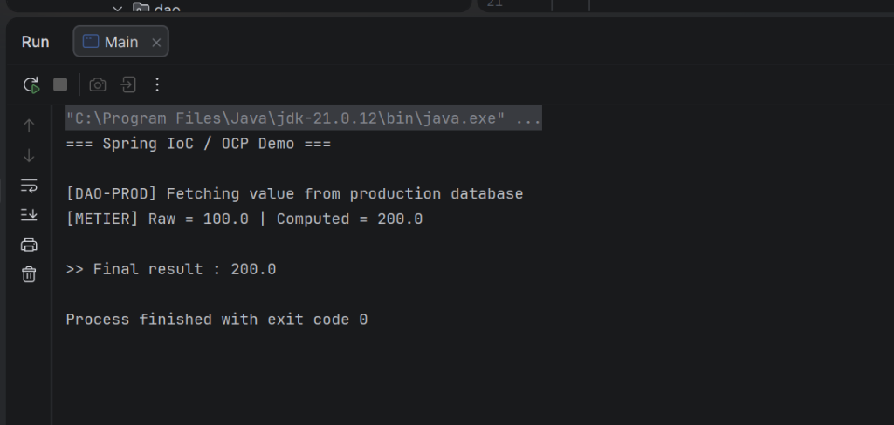

# TP3 — Spring IoC & OCP: Injection Strategies and Implementation Selection

> **Course:** Architecture Microservices — Conception, Déploiement et Orchestration  
> **Lab:** TP 3 — Spring Inversion of Control & Open/Closed Principle

---

## 📋 Table of Contents

- [Overview](#-overview)
- [Core Concepts](#-core-concepts)
- [Project Structure](#-project-structure)
- [Architecture Diagram](#-architecture-diagram)
- [Dependencies](#-dependencies)
- [Getting Started](#-getting-started)
- [DAO Implementations](#-dao-implementations)
- [Injection Strategies](#-injection-strategies)
  - [Strategy A — @Primary](#strategy-a--primary)
  - [Strategy B — Alias via @Bean](#strategy-b--alias-via-bean)
  - [Strategy C — External Properties](#strategy-c--external-properties)
- [Spring Profiles](#-spring-profiles)
- [Multi-DAO Injection](#-multi-dao-injection)
- [Running the Application](#-running-the-application)
- [Running Tests](#-running-tests)
- [Demo Output](#-demo-output)
- [Key Takeaways](#-key-takeaways)

---

## 🧩 Overview

This lab demonstrates how **Spring's IoC (Inversion of Control) container** can be used to implement the **Open/Closed Principle (OCP)** — one of the five SOLID design principles.

The goal: **swap the data source at runtime without ever modifying the business logic class** (`MetierImpl`). Three progressively flexible strategies are explored, from a simple compile-time annotation all the way to fully externalized configuration.

---

## 💡 Core Concepts

| Concept | Description |
|---|---|
| **IoC / Dependency Injection** | The container manages object creation and wires dependencies automatically |
| **Open/Closed Principle** | Classes are open for extension but closed for modification |
| **Constructor Injection** | Dependencies are declared as constructor parameters — explicit, immutable, testable |
| **@Primary** | Marks a bean as the default candidate when multiple beans of the same type exist |
| **@ComponentScan** | Instructs Spring to discover and register annotated classes in specified packages |
| **@PropertySource** | Loads an external `.properties` file into the Spring environment |

---

## 📁 Project Structure

```
tp3/
│
├── pom.xml                              # Maven config — Spring 6 + JUnit 4
│
├── src/
│   ├── main/
│   │   ├── java/
│   │   │   ├── Main.java                # Application entry point
│   │   │   │
│   │   │   ├── dao/
│   │   │   │   ├── IDao.java            # Data-access abstraction (interface)
│   │   │   │   ├── DaoImpl.java         # Production DB stub  (@Primary)
│   │   │   │   ├── DaoImpl2.java        # Development DB stub
│   │   │   │   ├── DaoFile.java         # Local file stub
│   │   │   │   ├── DaoApi.java          # External REST API stub
│   │   │   │   └── DaoImplProd.java     # Profile-gated prod bean
│   │   │   │
│   │   │   ├── metier/
│   │   │   │   ├── IMetier.java         # Business-layer abstraction
│   │   │   │   ├── MetierImpl.java      # Primary service — doubles DAO value
│   │   │   │   └── MetierMultiple.java  # Aggregates all DAO beans
│   │   │   │
│   │   │   └── config/
│   │   │       ├── AppConfig.java       # Root config — component scan + properties
│   │   │       ├── DaoAliasConfig.java  # Strategy B (alias via @Bean)
│   │   │       └── DynamicDaoConfig.java# Strategy C (property-driven selection)
│   │   │
│   │   └── resources/
│   │       └── app.properties           # External config: dao.target=dao
│   │
│   └── test/
│       └── java/test/
│           └── OcpSelectionTest.java    # JUnit non-regression test
│
└── docs/
    └── output_demo.png                  # Application run screenshot
```

---

## 🏗️ Architecture Diagram

```
┌─────────────────────────────────────────────────────────┐
│                   Spring IoC Container                   │
│                                                         │
│   ┌──────────────┐        ┌──────────────────────────┐  │
│   │  <<config>>  │        │      <<interface>>        │  │
│   │   AppConfig  │        │          IDao             │  │
│   └──────┬───────┘        └────────────┬─────────────┘  │
│          │ scans                       │ implements      │
│          ▼                   ┌─────────┼──────────────┐  │
│   ┌──────────────┐           │         │              │  │
│   │  <<service>> │    DaoImpl│  DaoImpl2│  DaoFile    │  │
│   │  MetierImpl  │◄──────────┤         │   DaoApi     │  │
│   └──────────────┘  inject   └─────────┴──────────────┘  │
│                     one IDao                             │
└─────────────────────────────────────────────────────────┘

       Main.java
          │
          │ getBean(IMetier.class)
          ▼
     MetierImpl.calcul()
          │
          │ dao.getValue()  → 100.0  (DaoImpl, @Primary)
          ▼
     result = 100.0 × 2 = 200.0
```

---

## 📦 Dependencies

| Library | Version | Purpose |
|---|---|---|
| `spring-context` | 6.1.6 | IoC container, component scanning, annotation support |
| `junit` | 4.13.2 | Unit testing framework |
| `spring-test` | 6.1.6 | Spring-aware test utilities |
| Java | 21 | Language runtime |
| Maven | 3.9+ | Build and dependency management |

---

## 🚀 Getting Started

### Prerequisites

- **Java 21** or higher installed
- **Maven 3.9+** available on PATH *(or use IntelliJ's bundled Maven runner)*

### Clone & Build

```bash
git clone https://github.com/<your-username>/tp3.git
cd tp3
mvn clean compile
```

---

## 🗄️ DAO Implementations

All four DAO classes implement the same `IDao` interface:

```java
public interface IDao {
    double getValue();
}
```

| Bean Name | Class | Simulated Source | Return Value |
|---|---|---|---|
| `dao` | `DaoImpl` | Production database | `100.0` |
| `dao2` | `DaoImpl2` | Development database | `150.0` |
| `daoFile` | `DaoFile` | Local file system | `180.0` |
| `daoApi` | `DaoApi` | External REST API | `220.0` |

Because `MetierImpl` only depends on the `IDao` **interface**, switching between these implementations requires **zero changes to the business logic**.

---

## 🔀 Injection Strategies

When Spring finds **four** beans implementing `IDao`, it raises a `NoUniqueBeanDefinitionException` unless you resolve the ambiguity. Three strategies are provided:

---

### Strategy A — `@Primary`

**File:** `src/main/java/dao/DaoImpl.java`

Add `@Primary` to the class you want as the default. Spring will prefer it over all other candidates.

```java
@Primary
@Component("dao")
public class DaoImpl implements IDao {
    public double getValue() {
        return 100.0;   // production value
    }
}
```

✅ **Active by default** in this project.  
⚠️ Changing the default requires modifying the source and recompiling.

---

### Strategy B — Alias via `@Bean`

**File:** `src/main/java/config/DaoAliasConfig.java`

A dedicated `@Configuration` class creates a factory method that returns whichever implementation is wanted. Only **this one file** needs to change — no DAO class, no metier class.

```java
@Configuration
public class DaoAliasConfig {

    @Bean
    @Primary
    public IDao daoAlias() {
        return new DaoFile();   // ← swap here without touching DaoFile itself
    }
}
```

> **To activate:** uncomment `@Configuration` on `DaoAliasConfig` and remove `@Primary` from `DaoImpl`.

---

### Strategy C — External Properties (Most Flexible)

**File:** `src/main/java/config/DynamicDaoConfig.java`  
**Config:** `src/main/resources/app.properties`

The active DAO is selected at runtime by reading `dao.target` from an external properties file. No recompilation is needed — just update the property and restart.

```properties
# app.properties
dao.target=daoApi
```

```java
@Configuration
public class DynamicDaoConfig {

    @Value("${dao.target:dao}")
    private String daoTarget;

    @Bean @Primary
    public IDao dynamicDao() {
        return switch (daoTarget) {
            case "dao"     -> new DaoImpl();
            case "dao2"    -> new DaoImpl2();
            case "daoFile" -> new DaoFile();
            case "daoApi"  -> new DaoApi();
            default -> throw new IllegalArgumentException("Unknown target: " + daoTarget);
        };
    }
}
```

| `dao.target` | Class injected | Expected result |
|---|---|---|
| `dao` | `DaoImpl` | `200.0` |
| `dao2` | `DaoImpl2` | `300.0` |
| `daoFile` | `DaoFile` | `360.0` |
| `daoApi` | `DaoApi` | `440.0` |

> **To activate:** uncomment `@Configuration` on `DynamicDaoConfig` and remove `@Primary` from `DaoImpl`.

---

## 🌐 Spring Profiles

**File:** `src/main/java/dao/DaoImplProd.java`

Spring's built-in profile mechanism allows beans to be activated only for a specific environment (`dev`, `prod`, `test`).

```java
@Component("daoProd")
@Profile("prod")
public class DaoImplProd implements IDao {
    public double getValue() { return 100.0; }
}
```

To activate a profile programmatically:

```java
AnnotationConfigApplicationContext ctx =
    new AnnotationConfigApplicationContext(AppConfig.class);
ctx.getEnvironment().setActiveProfiles("prod");
```

Or via JVM system property:

```bash
java -Dspring.profiles.active=prod -jar tp3.jar
```

---

## 🔢 Multi-DAO Injection

**File:** `src/main/java/metier/MetierMultiple.java`

Spring can also inject **all** registered `IDao` beans at once — as a `List` (ordered) or a `Map<String, IDao>` (keyed by bean name).

```java
@Service("metierMultiple")
public class MetierMultiple implements IMetier {

    private final List<IDao> daoList;
    private final Map<String, IDao> daoMap;

    public MetierMultiple(List<IDao> daoList, Map<String, IDao> daoMap) {
        this.daoList = daoList;
        this.daoMap  = daoMap;
    }

    @Override
    public double calcul() {
        // Aggregates all sources: 100 + 150 + 180 + 220 = 650
        return daoList.stream().mapToDouble(IDao::getValue).sum();
    }
}
```

This pattern is useful for **fan-out aggregation**, voting algorithms, or fallback chains.

---

## ▶️ Running the Application

```bash
# With Maven exec plugin
mvn exec:java -Dexec.mainClass="Main"

# Or package and run with Java directly
mvn package -DskipTests
java -cp target/tp3-1.0-SNAPSHOT.jar Main
```

---

## 🧪 Running Tests

```bash
mvn test
```

The `OcpSelectionTest` validates that:

1. The Spring container boots without errors
2. An `IMetier` bean is available
3. The returned value matches the expected result for the configured DAO

```
[INFO] Tests run: 1, Failures: 0, Errors: 0, Skipped: 0
[INFO] BUILD SUCCESS
```

---

## 🖥️ Demo Output

The screenshot below shows the application running under IntelliJ IDEA with **Strategy A** active (`DaoImpl` — production database):



```
=== Spring IoC / OCP Demo ===

[DAO-PROD] Fetching value from production database
[METIER] Raw = 100.0 | Computed = 200.0

>> Final result : 200.0

Process finished with exit code 0
```

---

## 🎯 Key Takeaways

| Principle | How it's applied |
|---|---|
| **Single Responsibility** | Each class has one job: `IDao` fetches data, `MetierImpl` computes, configs wire them |
| **Open/Closed** | Adding a new data source = adding a new class; no existing class is touched |
| **Dependency Inversion** | `MetierImpl` depends on the `IDao` abstraction, never on a concrete class |
| **Loose Coupling** | The business layer has no `import dao.DaoImpl` — it only knows `IDao` |

---

## 📄 License

This project is produced for academic purposes as part of the *Architecture Microservices* course.
