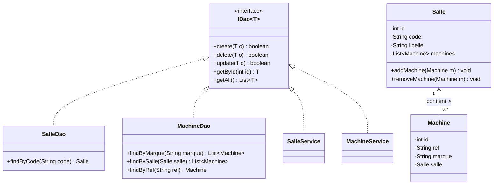
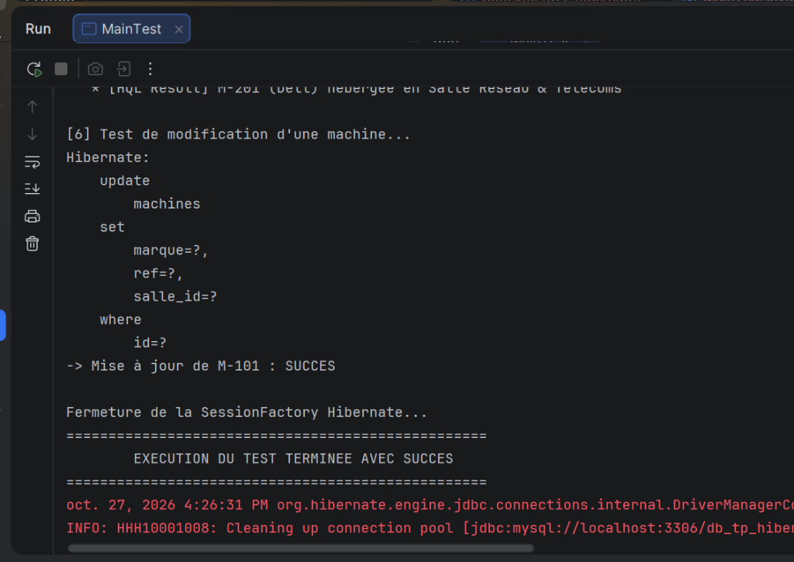

# TP4 : Persistance des Données avec Hibernate et MySQL


Ce projet est une application Java Maven illustrant la mise en œuvre de la persistance objet-relationnelle (ORM) avec le framework **Hibernate** et une base de données relationnelle **MySQL**. Il implémente les patrons de conception **DAO (Data Access Object)**, **Service métier**, et **Singleton** pour la gestion de session.

---

## 📋 Table des Matières

- [Architecture du Projet](#-architecture-du-projet)
- [Modèle de Données & Relations](#-modèle-de-données--relations)
- [Technologies & Dépendances](#-technologies--dépendances)
- [Structure du Code Source](#-structure-du-code-source)
- [Configuration d'Hibernate](#-configuration-dhibernate)
- [Fonctionnalités Implémentées](#-fonctionnalités-implémentées)
- [Exécution & Résultats](#-exécution--résultats)
- [Tests Automatisés JUnit 5](#-tests-automatisés-junit-5)
- [Guide de Démarrage Rapide](#-guide-de-démarrage-rapide)

---

## 🏛 Architecture du Projet

L'application adopte une architecture modulaire en couches garantissant un découplage fort entre l'accès aux données, les règles métier et les tests :

```
┌────────────────────────────────────────────────────────┐
│            Couche Présentation & Tests                │
│       MainTest.java  /  SalleServiceTest.java          │
└───────────────────────────┬────────────────────────────┘
                            │
┌───────────────────────────▼────────────────────────────┐
│                  Couche Service Métier                 │
│         SalleService.java  /  MachineService.java       │
└───────────────────────────┬────────────────────────────┘
                            │
┌───────────────────────────▼────────────────────────────┐
│                 Couche d'Accès aux Données             │
│            IDao<T>  (Contrat générique CRUD)           │
│           SalleDao.java   /   MachineDao.java          │
└───────────────────────────┬────────────────────────────┘
                            │
┌───────────────────────────▼────────────────────────────┐
│           ORM Hibernate & Utilitaire Session           │
│       HibernateUtil.java (SessionFactory Singleton)    │
│                     hibernate.cfg.xml                  │
└───────────────────────────┬────────────────────────────┘
                            │
┌───────────────────────────▼────────────────────────────┐
│                 Base de Données MySQL                  │
│                     db_tp_hibernate                    │
└────────────────────────────────────────────────────────┘
```

---

## 🧩 Modèle de Données & Relations

Le modèle repose sur deux entités reliées par une association **One-to-Many** bidirectionnelle :

- **`Salle`** : Représente un local ou laboratoire (attributs : `id`, `code`, `libelle`).
- **`Machine`** : Représente un poste ou serveur informatique (attributs : `id`, `ref`, `marque`, `salle_id`).

### Diagramme de Classes



---

## 🛠 Technologies & Dépendances

| Composant | Version | Rôle |
| :--- | :--- | :--- |
| **Java JDK** | 21+ / 17 | Langage d'exécution |
| **Apache Maven** | 3.9+ | Outil de build et gestion des dépendances |
| **Hibernate Core** | `5.6.15.Final` | Framework ORM / Mapping JPA |
| **MySQL Connector/J** | `8.0.33` | Pilote JDBC pour la connexion MySQL |
| **JUnit Jupiter** | `5.9.2` | Framework d'automatisation des tests |

---

## 📂 Structure du Code Source

```
tp4/
├── pom.xml                                      # Configuration Maven (dépendances & plugins)
├── mvnw / mvnw.cmd                              # Maven Wrapper pour exécution autonome
├── screenshots/
│   └── execution-test.png                       # Capture de l'exécution validée
└── src/
    ├── main/
    │   ├── java/
    │   │   ├── dao/
    │   │   │   ├── IDao.java                    # Interface générique des opérations CRUD
    │   │   │   ├── SalleDao.java                # Implémentation DAO pour les salles
    │   │   │   └── MachineDao.java              # Implémentation DAO pour les machines
    │   │   ├── entities/
    │   │   │   ├── Salle.java                   # Entité persistante Salle
    │   │   │   └── Machine.java                 # Entité persistante Machine
    │   │   ├── services/
    │   │   │   ├── SalleService.java            # Service métier pour Salle
    │   │   │   └── MachineService.java          # Service métier pour Machine
    │   │   ├── util/
    │   │   │   └── HibernateUtil.java           # Gestionnaire de SessionFactory & arrêt propre
    │   │   └── test/
    │   │       └── MainTest.java                # Programme de démonstration console
    │   └── resources/
    │       └── hibernate.cfg.xml                # Configuration de connexion Hibernate
    └── test/
        └── java/
            └── services/
                ├── SalleServiceTest.java        # Tests unitaires JUnit pour Salle
                └── MachineServiceTest.java      # Tests unitaires JUnit pour Machine
```

---

## ⚙️ Configuration d'Hibernate

Le fichier [`hibernate.cfg.xml`](src/main/resources/hibernate.cfg.xml) centralise les paramètres :

- **Pilote JDBC** : `com.mysql.cj.jdbc.Driver`
- **URL de connexion** : `jdbc:mysql://localhost:3306/db_tp_hibernate?useSSL=false&serverTimezone=UTC&allowPublicKeyRetrieval=true`
- **Dialecte SQL** : `org.hibernate.dialect.MySQL8Dialect`
- **Génération automatique du schéma** : `hbm2ddl.auto = update` (création et mise à jour automatique des tables `salles` et `machines` au démarrage)
- **Traçabilité SQL** : `show_sql = true` et `format_sql = true` pour afficher et formater les requêtes générées.

---

## 🚀 Fonctionnalités Implémentées

1. **Opérations CRUD Complètes** :
   - Insertion (`create`), modification (`update`), suppression (`delete`), consultation par ID (`getById`) et liste complète (`getAll`).
2. **Requêtes Objet HQL (Hibernate Query Language)** :
   - Recherche de machines par marque : `from Machine m where m.marque = :marque`
   - Recherche de machines par salle d'affectation : `from Machine m where m.salle = :salle`
   - Recherche par code ou référence unique.
3. **Sécurité Transactionnelle** :
   - Bloc `try-with-resources` garantissant la libération des sessions Hibernate.
   - Rollback systématique en cas d'erreur (`if (tx != null && tx.isActive()) tx.rollback();`).
4. **Gestion Propre des Ressources** :
   - Fermeture automatique du pool de connexions et arrêt du thread de surveillance JDBC MySQL (`AbandonedConnectionCleanupThread.checkedShutdown()`).

---

## 📸 Exécution & Résultats

L'exécution de la classe [`MainTest`](src/main/java/test/MainTest.java) permet de valider le cycle de vie complet de la persistance : création de salles, association de machines, requêtes HQL, modification d'entité et clôture transactionnelle.

<p align="center">
  
</p>

```
==================================================
   DEMARRAGE DU TEST DE PERSISTANCE HIBERNATE   
==================================================

[1] Création et insertion des salles...
-> Salles créées avec succès (IDs générés : S1, S2)

[2] Création et affectation des machines...
-> 4 machines insérées et reliées aux salles.

[3] Liste des salles enregistrées :
   - ID: 1 | Code: S1 | Libellé: Salle Informatique
   - ID: 2 | Code: S2 | Libellé: Salle Réseau & Télécoms

[4] Liste de toutes les machines :
   - ID: 1 | Ref: M-101 | Marque: Dell | Salle: S1
   - ID: 2 | Ref: M-102 | Marque: HP | Salle: S1
   - ID: 3 | Ref: M-201 | Marque: Dell | Salle: S2
   - ID: 4 | Ref: M-202 | Marque: Lenovo | Salle: S2

[5] Test requête avancée HQL - Machines de marque 'Dell' :
   * [HQL Result] M-101 (Dell) hébergée en Salle Informatique
   * [HQL Result] M-201 (Dell) hébergée en Salle Réseau & Télécoms

[6] Test de modification d'une machine...
-> Mise à jour de M-101 : SUCCES

Fermeture de la SessionFactory Hibernate...
==================================================
        EXECUTION DU TEST TERMINEE AVEC SUCCES    
==================================================
```

---

## 🧪 Tests Automatisés JUnit 5

Une suite complète de tests unitaires valide l'intégrité de la persistance :

- **`SalleServiceTest`** :
  - `testCreateSalle` : Vérifie l'insertion et l'assignation de l'ID auto-incrémenté.
  - `testGetById` : Contrôle la lecture unitaire.
  - `testUpdateSalle` : Valide la mise à jour des champs.
  - `testGetAll` : Assure la récupération collective des enregistrements.
  - `testDeleteSalle` : Vérifie la suppression physique de l'entité.
- **`MachineServiceTest`** :
  - `testCreateMachineAvecSalle` : Valide la liaison étrangère foreign key `salle_id`.
  - `testFindByMarque` : Valide la requête paramétrée HQL.

---

## 💻 Guide de Démarrage Rapide

### 1. Prérequis
- **MySQL Server** (XAMPP, WampServer ou service natif) démarré sur le port par défaut `3306`.
- Créer la base de données (si elle n'existe pas encore) :
  ```sql
  CREATE DATABASE IF NOT EXISTS db_tp_hibernate;
  ```

### 2. Cloner le dépôt
```bash
git clone https://github.com/votre-compte/tp4-hibernate.git
cd tp4-hibernate
```

### 3. Lancer les tests unitaires
```powershell
# Sur Windows
.\mvnw.cmd test

# Sur Linux / macOS
./mvnw test
```

### 4. Exécuter l'application principale
```powershell
# Sur Windows
.\mvnw.cmd compile exec:java

# Sur Linux / macOS
./mvnw compile exec:java
```

---

## 📄 Licence

Ce projet est réalisé dans un cadre académique pour l'apprentissage des architectures orientées services et des technologies de persistance Java/JPA.
