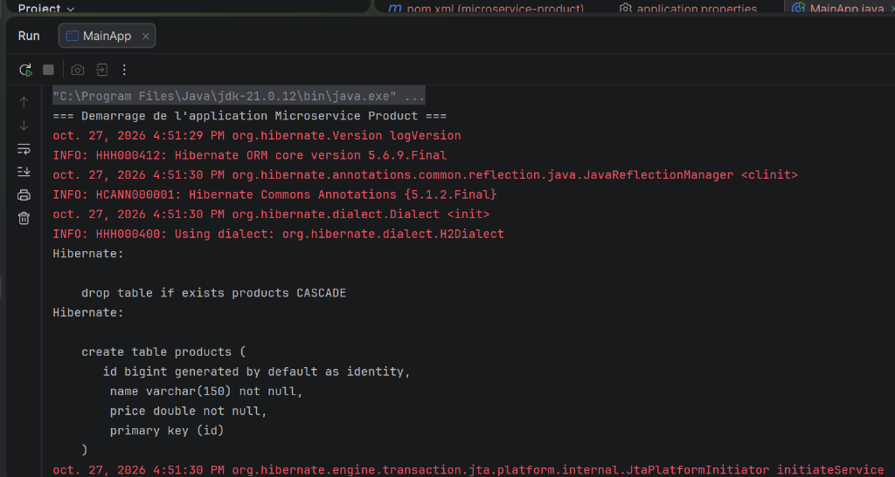
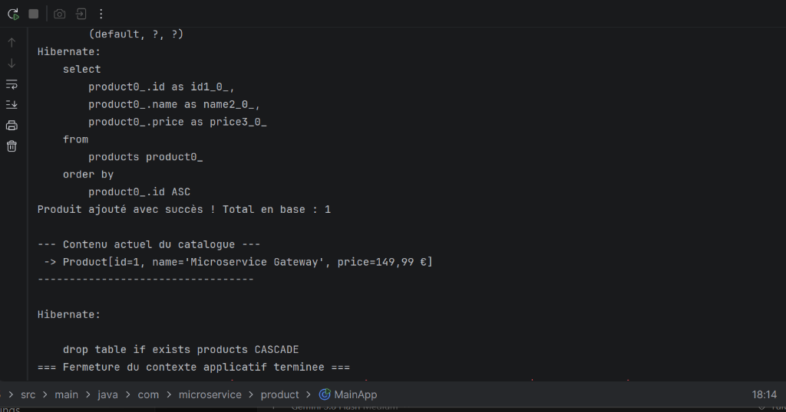

# Microservice Product — Architecture de Persistance Spring & Hibernate

[](https://www.oracle.com/java/)
[](https://spring.io/)
[](https://hibernate.org/)
[](https://maven.apache.org/)

---

## 1. Contexte du Projet

Ce projet implémente un module autonome de gestion de catalogue produits (**`microservice-product`**) structuré selon les standards d'une architecture microservice en couches étanches :
* **Couche Présentation / Exécution** : lanceurs et démonstrateurs de scénarios métier.
* **Couche Service (Métier)** : isolation des règles d'intégrité (contrôle des prix, non-vacuité des noms) et délimitation transactionnelle.
* **Couche DAO (Data Access Object)** : pattern générique `<T>` abstrayant les requêtes Hibernate et la `SessionFactory`.
* **Couche Entité (JPA)** : mapping objet-relationnel sur la table `products`.
* **Couche Configuration** : configuration 100% Java (`@Configuration`) sans fichier XML legacy.

---

## 2. Arborescence du Code Source

```text
microservice-product/
├── pom.xml
├── README.md
├── docs/
│   └── screenshots/
│       ├── 01-demarrage-hibernate.png
│       └── 02-resultat-execution.png
└── src/
    ├── main/
    │   ├── java/
    │   │   └── com/microservice/product/
    │   │       ├── MainApp.java                    # Scénario complet d'exécution
    │   │       ├── TestHibernate.java              # Test unitaire de connectivité
    │   │       ├── config/
    │   │       │   ├── AppConfig.java              # Balayage des composants (@ComponentScan)
    │   │       │   ├── HibernateConfig.java        # DataSource & LocalSessionFactoryBean
    │   │       │   └── TransactionConfig.java      # HibernateTransactionManager
    │   │       ├── dao/
    │   │       │   ├── IDao.java                   # Contrat générique CRUD <T>
    │   │       │   └── ProductDaoImpl.java         # Implémentation SessionFactory
    │   │       ├── entity/
    │   │       │   └── Product.java                # Entité persistante JPA
    │   │       └── service/
    │   │           ├── ProductService.java         # Interface métier
    │   │           └── ProductServiceImpl.java     # Logique de validation & @Transactional
    │   └── resources/
    │       └── application.properties              # Paramètres MySQL / H2
    └── test/
        ├── java/
        │   └── com/microservice/product/
        │       ├── ProductIntegrationTest.java     # Test d'intégration Spring + Hibernate
        │       ├── config/TestHibernateConfig.java # Configuration test H2
        │       └── service/ProductServiceTest.java # Tests unitaires Mockito
        └── resources/
            └── application-test.properties         # Propriétés de test isolées
```

---

## 3. Choix d'Architecture & Conception

* **Pattern DAO Générique (`IDao<T>`)** : permet la réutilisabilité des méthodes élémentaires (`save`, `update`, `delete`, `findById`, `findAll`) pour n'importe quelle entité du domaine.
* **Découplage Interface / Implémentation** : utilisation d'une interface `ProductService` injectée par constructeur (`@Autowired`) pour une testabilité maximale et un respect strict des principes SOLID.
* **Gestion Déclarative des Transactions** : mise en place de `@EnableTransactionManagement(proxyTargetClass = true)` garantissant l'intégrité ACID sans gestion manuelle des sessions.
* **Contrôle Métier Défensif** : levée d'exceptions explicites (`IllegalArgumentException`) lorsque les préconditions ne sont pas remplies (prix négatif, nom manquant).

---

## 4. Guide d'Exécution

### Prérequis
* JDK 17 ou JDK 21
* Apache Maven 3.8+
* Serveur MySQL 8 (ou utilisation de la base H2 embarquée préconfigurée)

### Configuration (`application.properties`)
Le fichier `src/main/resources/application.properties` centralise la connexion :
```properties
jdbc.driver=com.mysql.cj.jdbc.Driver
jdbc.url=jdbc:mysql://localhost:3306/product_db?createDatabaseIfNotExist=true&useSSL=false&serverTimezone=UTC&allowPublicKeyRetrieval=true
jdbc.username=root
jdbc.password=secret

hibernate.dialect=org.hibernate.dialect.MySQL8Dialect
hibernate.show_sql=true
hibernate.format_sql=true
hibernate.hbm2ddl.auto=update
```

> **Astuce d'exécution autonome** : Si vous ne disposez pas d'un serveur MySQL actif localement, le fichier contient un profil H2 prêt à être décommenté pour une exécution instantanée en mémoire.

### Commandes de Compilation et de Test

```bash
# Compilation du projet
mvn clean compile

# Exécution de la suite de tests automatisés (Unitaires Mockito + Intégration)
mvn test

# Lancement de l'application principale
mvn compile exec:java
```

---

## 5. Preuves de Fonctionnement

Les captures d'écran ci-dessous attestent du bon fonctionnement du microservice lors de l'exécution de `MainApp` :

### Étape 1 : Initialisation Spring & DDL Hibernate
Chargement du contexte Spring IoC, détection du dialecte de base de données, initialisation de la `SessionFactory` et génération automatique du schéma de table `products`.



---

### Étape 2 : Opérations CRUD & Fermeture Propre
Exécution des requêtes SQL d'insertion et de sélection ordonnée (`SELECT ... FROM products ... ORDER BY id ASC`), validation de l'enregistrement en base, affichage du catalogue formaté, puis libération des ressources.



---

## 6. Bilan des Tests Automatisés

Le projet inclut une couverture de tests automatisés vérifiée avec succès :
* `ProductServiceTest` : vérifie la validation métier (rejet des prix négatifs, noms nuls) et la délégation au DAO à l'aide de Mockito.
* `ProductIntegrationTest` : valide le cycle de vie complet de l'entité (création, relecture, mise à jour) contre une base de données relationnelle en mémoire.

```text
[INFO] Running com.microservice.product.ProductIntegrationTest
[INFO] Tests run: 1, Failures: 0, Errors: 0, Skipped: 0
[INFO] Running com.microservice.product.service.ProductServiceTest
[INFO] Tests run: 4, Failures: 0, Errors: 0, Skipped: 0
[INFO] BUILD SUCCESS (5 tests passés avec succès)
```
