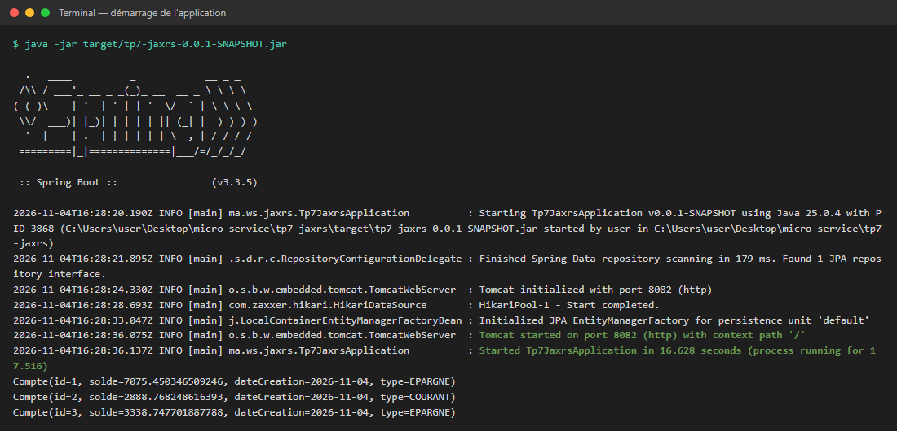
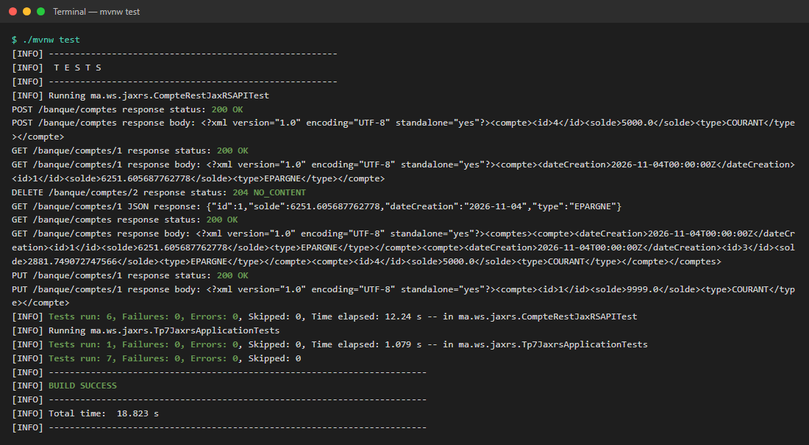
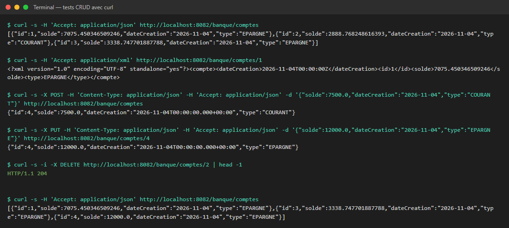
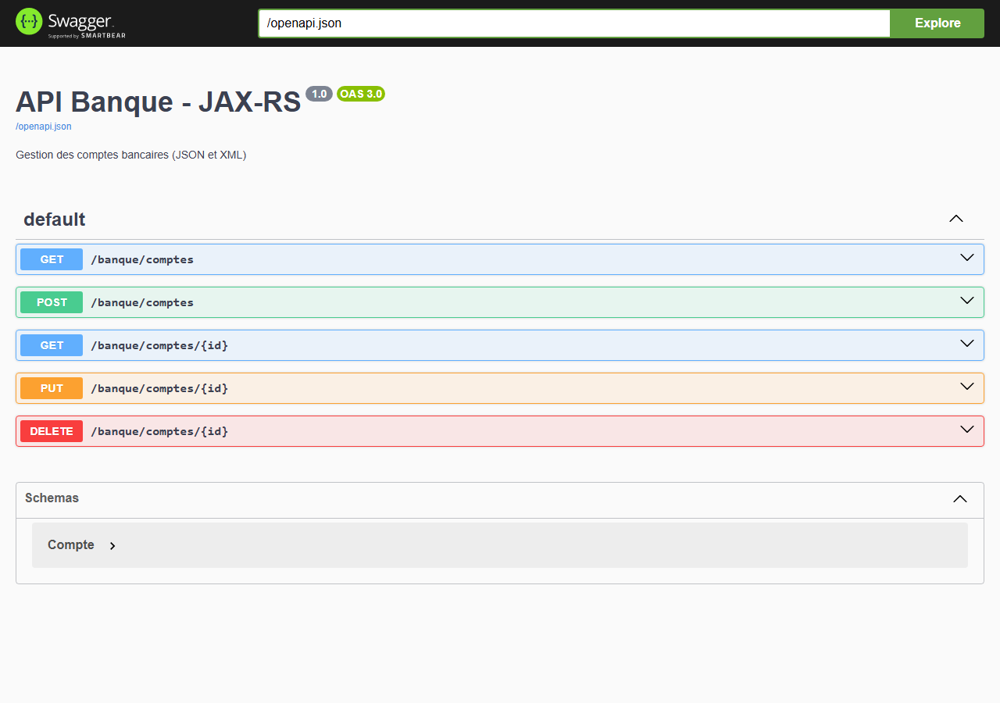
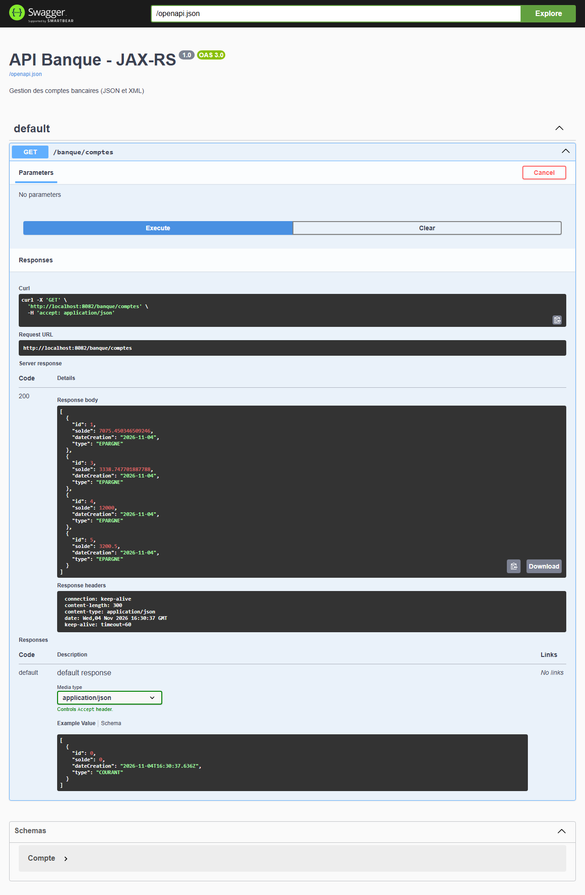
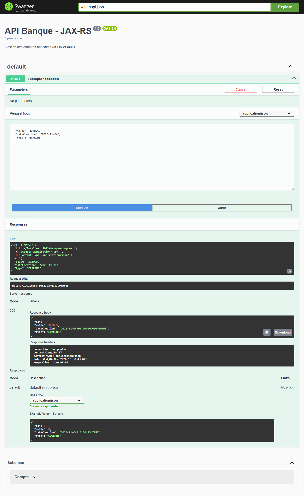
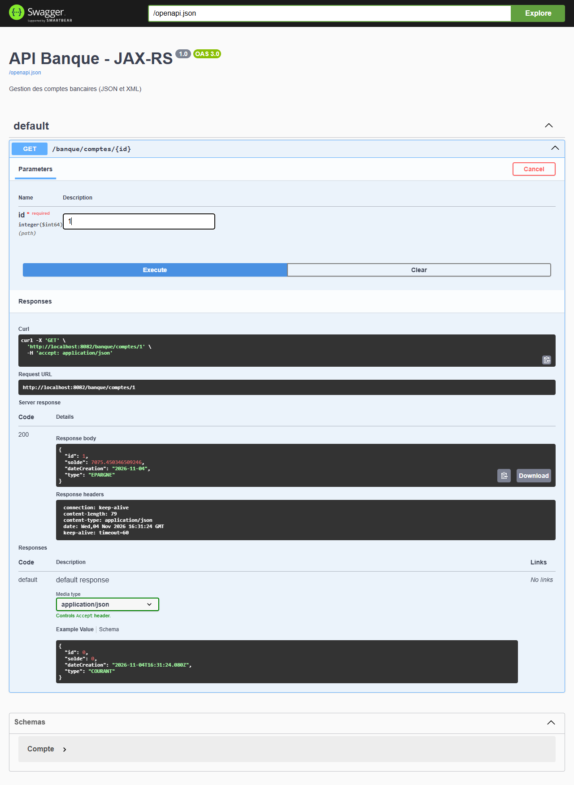
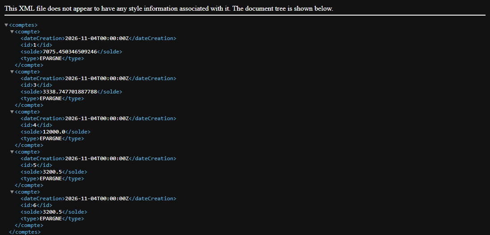

# TP7 – Web services RESTful avec JAX-RS (Jersey) et Spring Boot

Dans ce TP, j'ai construit une petite API REST pour gérer des **comptes bancaires**.
Spring Boot n'expose pas les routes avec `@RestController` ici. J'ai utilisé à la place la spécification **JAX-RS**,
implémentée par **Jersey**. L'API répond aussi bien en **JSON** qu'en **XML**, selon l'en-tête `Accept` envoyé par le client.

---

## Sommaire

1. [Objectifs](#1-objectifs)
2. [Technologies utilisées](#2-technologies-utilisées)
3. [Structure du projet](#3-structure-du-projet)
4. [Explication du code](#4-explication-du-code)
5. [Endpoints de l'API](#5-endpoints-de-lapi)
6. [Lancer le projet](#6-lancer-le-projet)
7. [Tests et captures d'écran](#7-tests-et-captures-décran)
8. [Problème rencontré : Swagger en 404](#8-problème-rencontré--swagger-en-404)
9. [Conclusion](#9-conclusion)

---

## 1. Objectifs

- Comprendre comment JAX-RS s'intègre dans une application Spring Boot avec `spring-boot-starter-jersey`.
- Écrire une ressource REST avec les annotations `@Path`, `@GET`, `@POST`, `@PUT`, `@DELETE`, `@Produces` et `@Consumes`.
- Renvoyer les mêmes données en JSON (Jackson) et en XML (JAXB).
- Stocker les comptes dans une base H2 en mémoire avec Spring Data JPA.
- Tester l'API de plusieurs façons : tests JUnit, `curl`, Swagger UI et Postman.

## 2. Technologies utilisées

| Outil | Version | Rôle |
|-------|---------|------|
| Java | 17+ (testé avec 25) | Langage |
| Spring Boot | 3.3.5 | Framework principal |
| Jersey (`spring-boot-starter-jersey`) | 3.1.x | Implémentation de JAX-RS |
| Spring Data JPA + Hibernate | 6.5 | Accès aux données |
| H2 | – | Base de données en mémoire |
| Jackson / JAXB | – | Sérialisation JSON / XML |
| Lombok | 1.18.38 | Génère getters, setters et constructeurs |
| springdoc-openapi + swagger-jaxrs2 | 2.6.0 / 2.2.22 | Documentation Swagger |
| JUnit 5 + TestRestTemplate | – | Tests d'intégration |
| Maven Wrapper | – | Build |

## 3. Structure du projet

```
tp7-jaxrs
├── pom.xml
├── postman/
│   └── TP7-JAXRS-Banque.postman_collection.json   ← collection prête à importer
├── screenshots/                                   ← captures utilisées dans ce README
└── src
    ├── main
    │   ├── java/ma/ws/jaxrs
    │   │   ├── Tp7JaxrsApplication.java        ← point d'entrée + données de départ
    │   │   ├── config/MyConfig.java            ← configuration de Jersey et d'OpenAPI
    │   │   ├── controllers/CompteRestJaxRSAPI.java ← ressource REST (CRUD)
    │   │   ├── entities/Compte.java            ← entité JPA
    │   │   ├── entities/TypeCompte.java        ← enum COURANT / EPARGNE
    │   │   └── repositories/CompteRepository.java ← interface JpaRepository
    │   └── resources/application.properties
    └── test/java/ma/ws/jaxrs
        ├── CompteRestJaxRSAPITest.java         ← tests des endpoints
        └── Tp7JaxrsApplicationTests.java       ← test de chargement du contexte
```

Le projet suit une architecture en couches classique :

```
Client (curl / Postman / Swagger)
        │  HTTP (JSON ou XML)
        ▼
CompteRestJaxRSAPI  (couche web – Jersey)
        │
        ▼
CompteRepository    (couche d'accès aux données – Spring Data JPA)
        │
        ▼
Base H2 en mémoire  (jdbc:h2:mem:banque)
```

## 4. Explication du code

### 4.1 L'entité `Compte`

```java
@Entity
@Data @NoArgsConstructor @AllArgsConstructor
@XmlRootElement
public class Compte {
    @Id @GeneratedValue(strategy = GenerationType.IDENTITY)
    private Long id;
    private double solde;
    @Temporal(TemporalType.DATE)
    private Date dateCreation;
    @Enumerated(EnumType.ORDINAL)
    private TypeCompte type;
}
```

- `@Entity` : la classe devient une table de la base.
- `@XmlRootElement` : JAXB a besoin de cette annotation pour convertir l'objet en XML (`<compte>...</compte>`).
  Sans elle, la réponse XML échoue.
- `TypeCompte` est une enum avec deux valeurs : `COURANT` et `EPARGNE`.

### 4.2 Le repository

```java
public interface CompteRepository extends JpaRepository<Compte, Long> { }
```

Le repository est une interface vide. Spring Data génère automatiquement `findAll`, `findById`, `save` et `deleteById`.

### 4.3 La ressource JAX-RS

La classe `CompteRestJaxRSAPI` est annotée `@Component`, ce qui permet à Spring d'y injecter le repository.
Elle porte aussi `@Path("/banque")`, ce qui fait de Jersey le gestionnaire de ses routes.
Chaque méthode déclare les formats acceptés :

```java
@Path("/comptes")
@GET
@Produces({MediaType.APPLICATION_JSON, MediaType.APPLICATION_XML})
public List<Compte> getComptes() {
    return compteRepository.findAll();
}
```

Jersey compare l'en-tête `Accept` de la requête avec la liste `@Produces` et choisit automatiquement le bon convertisseur.

### 4.4 La configuration de Jersey (`MyConfig`)

```java
@Bean
public ResourceConfig resourceConfig() {
    ResourceConfig jerseyServlet = new ResourceConfig();
    jerseyServlet.register(CompteRestJaxRSAPI.class);
    // + enregistrement de OpenApiResource pour générer /openapi.json
    // + FILTER_FORWARD_ON_404 pour laisser passer /swagger-ui vers Spring MVC
    return jerseyServlet;
}
```

`ResourceConfig` sert à déclarer à Jersey les classes ressources qu'il doit exposer.

### 4.5 Les données de départ

Au démarrage, un `CommandLineRunner` insère trois comptes avec un solde aléatoire et les affiche dans la console
(voir la [capture 1](#71-démarrage-de-lapplication)).

### 4.6 `application.properties`

```properties
spring.application.name=tp7-jaxrs
spring.datasource.url=jdbc:h2:mem:banque
server.port=8082
spring.jersey.type=filter

# Swagger UI lit la spec générée par Jersey
springdoc.swagger-ui.url=/openapi.json
```

- L'application écoute sur le port **8082**.
- `spring.jersey.type=filter` : Jersey fonctionne comme un *filtre* et non comme une servlet.
  Il peut ainsi cohabiter avec Spring MVC, qui sert les pages de Swagger UI.

## 5. Endpoints de l'API

URL de base : `http://localhost:8082/banque`

| Méthode | URL | Description | Corps de la requête | Réponse |
|---------|-----|-------------|---------------------|---------|
| GET | `/comptes` | Liste tous les comptes | – | 200 + liste |
| GET | `/comptes/{id}` | Renvoie un compte | – | 200 + compte |
| POST | `/comptes` | Ajoute un compte | JSON ou XML | 200 + compte créé |
| PUT | `/comptes/{id}` | Modifie solde, date et type | JSON ou XML | 200 + compte modifié |
| DELETE | `/comptes/{id}` | Supprime un compte | – | 204 No Content |

Exemple de corps JSON :

```json
{
  "solde": 7500.0,
  "dateCreation": "2026-11-04",
  "type": "COURANT"
}
```

Le même compte au format XML :

```xml
<compte>
  <solde>7500.0</solde>
  <type>COURANT</type>
</compte>
```

## 6. Lancer le projet

**Prérequis :** JDK 17 ou plus récent. Maven n'est pas nécessaire, car le wrapper `mvnw` est fourni.

```bash
# 1. Cloner le dépôt
git clone <url-du-depot>
cd tp7-jaxrs

# 2. Lancer l'application
./mvnw spring-boot:run          # Linux / macOS / Git Bash
mvnw.cmd spring-boot:run        # Windows (cmd)

# ou bien construire le jar puis l'exécuter
./mvnw clean package
java -jar target/tp7-jaxrs-0.0.1-SNAPSHOT.jar
```

Une fois l'application démarrée :

| Ressource | Adresse |
|-----------|---------|
| API | http://localhost:8082/banque/comptes |
| Swagger UI | http://localhost:8082/swagger-ui/index.html |
| Spécification OpenAPI | http://localhost:8082/openapi.json |

Pour lancer les tests :

```bash
./mvnw test
```

## 7. Tests et captures d'écran

### 7.1 Démarrage de l'application

Tomcat démarre sur le port 8082. Les trois comptes créés par le `CommandLineRunner` s'affichent ensuite dans la console.



### 7.2 Tests JUnit (`./mvnw test`)

La classe `CompteRestJaxRSAPITest` démarre le serveur sur un port aléatoire et envoie de vraies requêtes HTTP
avec `TestRestTemplate`. Elle couvre six cas :

| Test | Ce qui est vérifié |
|------|--------------------|
| `testGetComptesXml` | GET de la liste en XML → 200 |
| `testGetCompteXml` | GET d'un compte en XML → contient `<compte>` |
| `testGetCompteJson` | GET d'un compte en JSON → contient `"solde":` |
| `testPostCompteXml` | POST d'un compte en XML → 200 |
| `testPutCompteXml` | PUT du compte 1 → nouveau solde `9999.0` |
| `testDeleteCompte` | DELETE du compte 2 → 204 |

Résultat : **7 tests, 0 échec** (le septième est `contextLoads`).



### 7.3 Tests manuels avec `curl`

J'ai enchaîné toutes les opérations CRUD : lister, lire un compte en XML, créer, modifier, supprimer, puis relister.
La dernière commande montre que le compte 2 a bien disparu et que le compte 4 a été modifié.



Commandes utilisées :

```bash
curl -H "Accept: application/json" http://localhost:8082/banque/comptes
curl -H "Accept: application/xml"  http://localhost:8082/banque/comptes/1
curl -X POST -H "Content-Type: application/json" -d '{"solde":7500.0,"dateCreation":"2026-11-04","type":"COURANT"}' http://localhost:8082/banque/comptes
curl -X PUT  -H "Content-Type: application/json" -d '{"solde":12000.0,"dateCreation":"2026-11-04","type":"EPARGNE"}' http://localhost:8082/banque/comptes/4
curl -X DELETE http://localhost:8082/banque/comptes/2
```

### 7.4 Swagger UI

Vue d'ensemble : les 5 opérations de la ressource et le schéma `Compte`.



**GET /banque/comptes** exécuté depuis Swagger :



**POST /banque/comptes** : création d'un compte. La réponse contient l'`id` généré par la base.



**GET /banque/comptes/{id}** avec `id = 1` :



### 7.5 Réponse XML dans le navigateur

Le navigateur envoie `Accept: text/html,application/xml,...`, donc Jersey choisit XML.
JAXB enveloppe la liste dans une balise `<comptes>`.



### 7.6 Postman

Une collection prête à l'emploi se trouve dans [`postman/TP7-JAXRS-Banque.postman_collection.json`](postman/TP7-JAXRS-Banque.postman_collection.json).
Pour l'utiliser : **Import** → choisir le fichier, puis lancer les requêtes une par une.
Elle contient 7 requêtes : liste en JSON, liste en XML, consultation, création en JSON, création en XML, modification et suppression.

<!-- Ajouter ici vos captures Postman, par exemple :


-->

## 8. Problème rencontré : Swagger en 404

Au départ, la dépendance `springdoc-openapi-starter-webmvc-ui` était présente, mais
`http://localhost:8082/swagger-ui/index.html` renvoyait **404**. J'ai trouvé deux causes :

1. **Jersey interceptait toutes les URLs.** Avec `spring.jersey.type=filter`, Jersey se place devant Spring MVC.
   Quand il ne connaît pas une route, il répond lui-même 404, au lieu de passer la main.
   **Solution :** activer `ServletProperties.FILTER_FORWARD_ON_404` dans `MyConfig`.
2. **springdoc ne lit que les contrôleurs Spring MVC.** Il ignore les ressources JAX-RS, donc la documentation était vide.
   **Solution :** ajouter `swagger-jaxrs2-jakarta` et enregistrer `OpenApiResource` dans Jersey.
   La spec est alors générée sur `/openapi.json` et Swagger UI la lit grâce à `springdoc.swagger-ui.url=/openapi.json`.
   J'ai limité l'analyse à `CompteRestJaxRSAPI` pour ne pas afficher les routes WADL internes de Jersey.

## 9. Conclusion

Ce TP m'a montré qu'on peut garder un code basé sur le **standard JAX-RS**, donc portable vers d'autres serveurs,
tout en profitant de Spring Boot (injection, JPA, configuration automatique).
La négociation de contenu est le point le plus intéressant : une seule méthode Java sert à la fois du JSON et du XML,
sans code supplémentaire.

Pistes d'amélioration :
- renvoyer **404** au lieu d'un corps vide quand un compte n'existe pas (avec `Response` ou une `NotFoundException`) ;
- renvoyer **201 Created** pour la création ;
- ajouter une couche *service* et des DTO ;
- valider les données avec `@Valid`.

---

**Auteur :** Mouad Handaji – Module Micro-services
