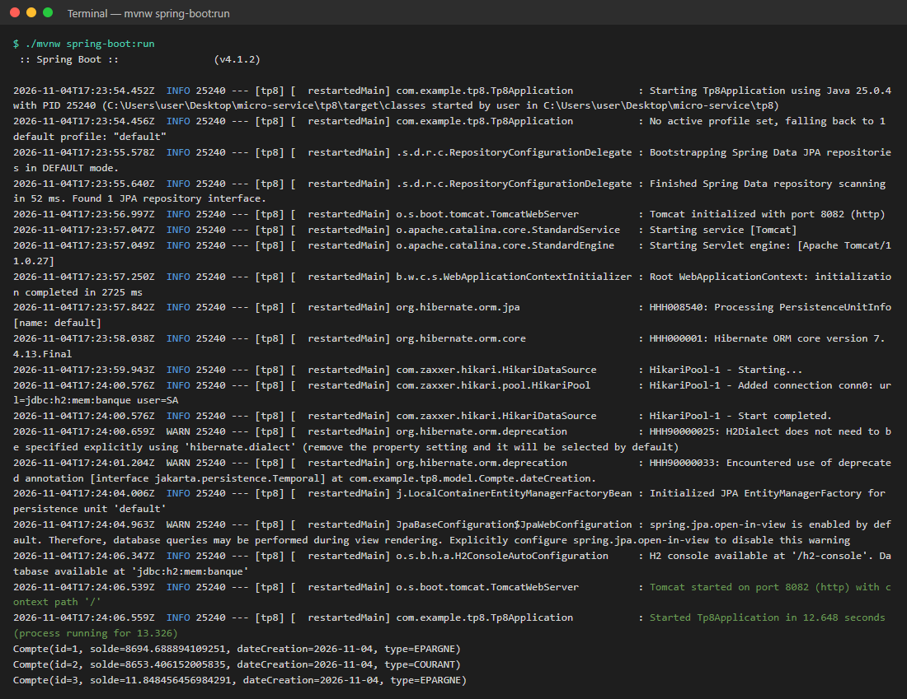
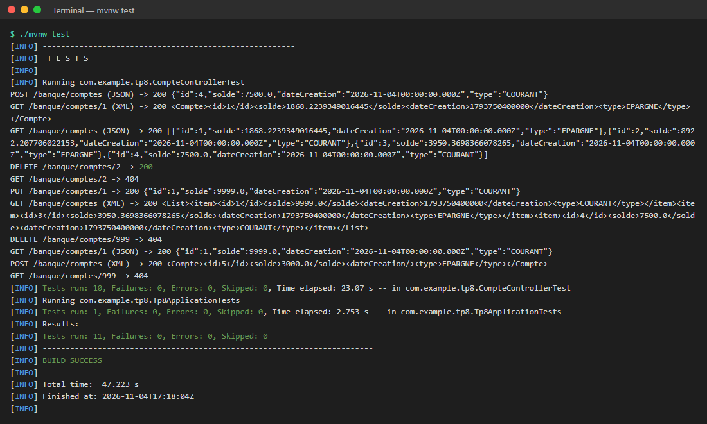
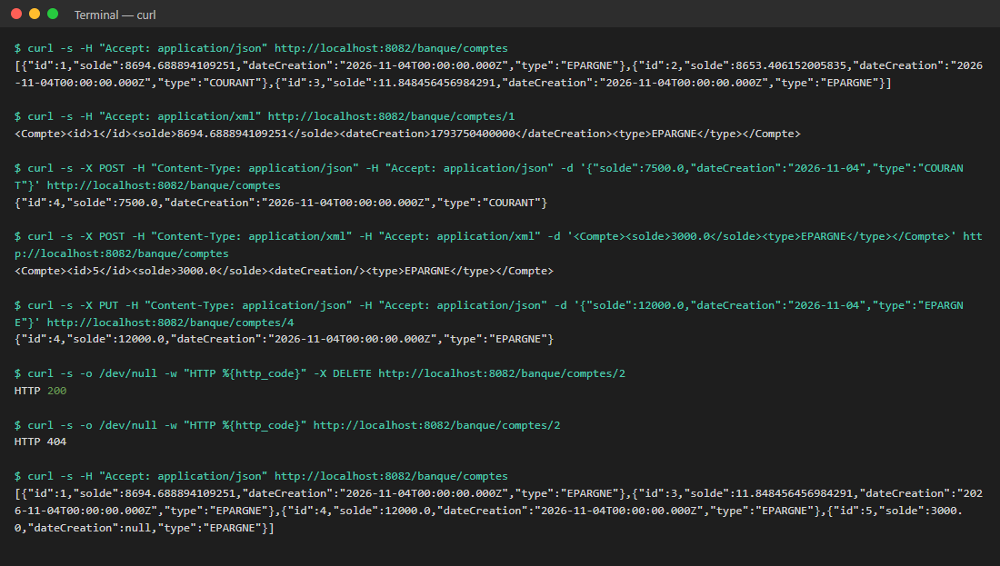
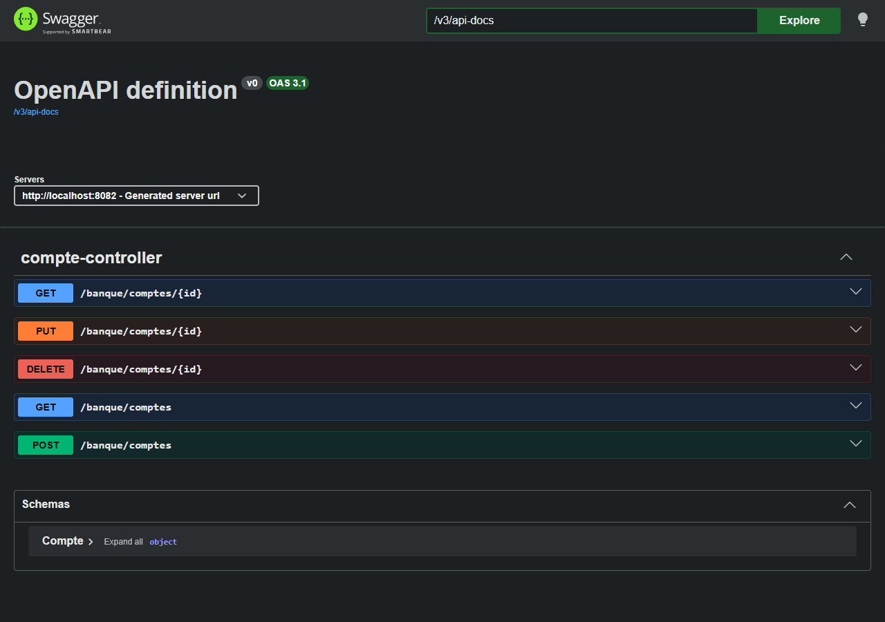
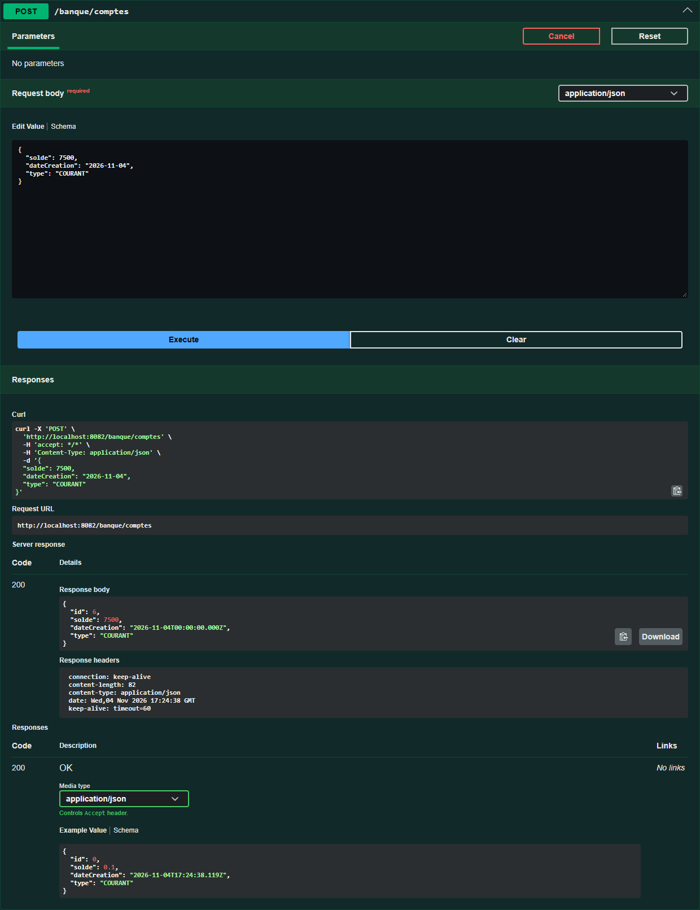
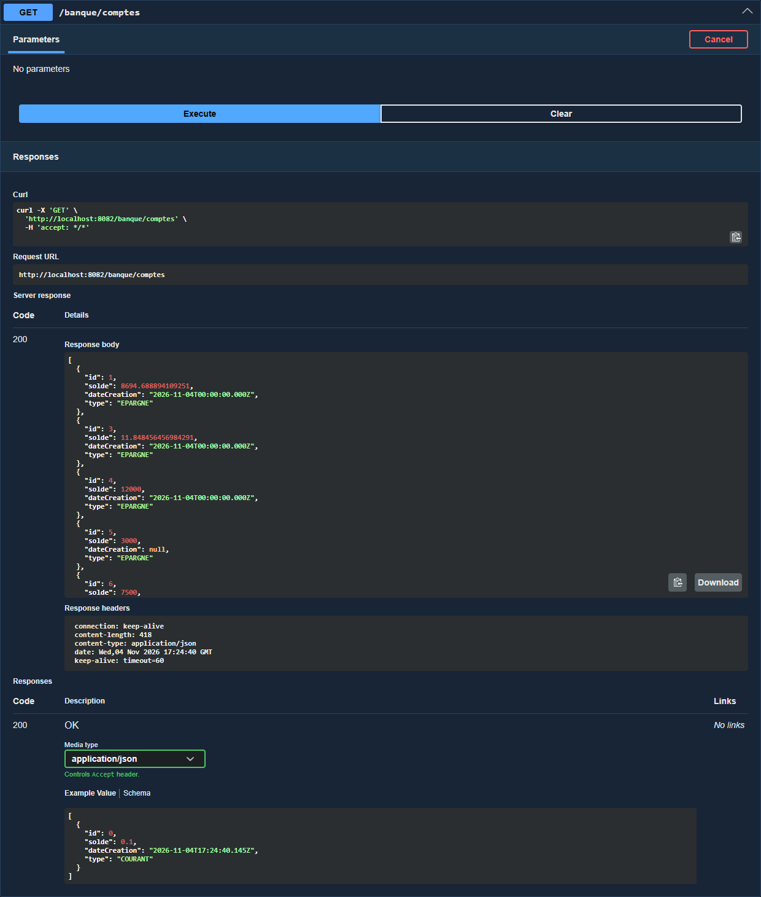
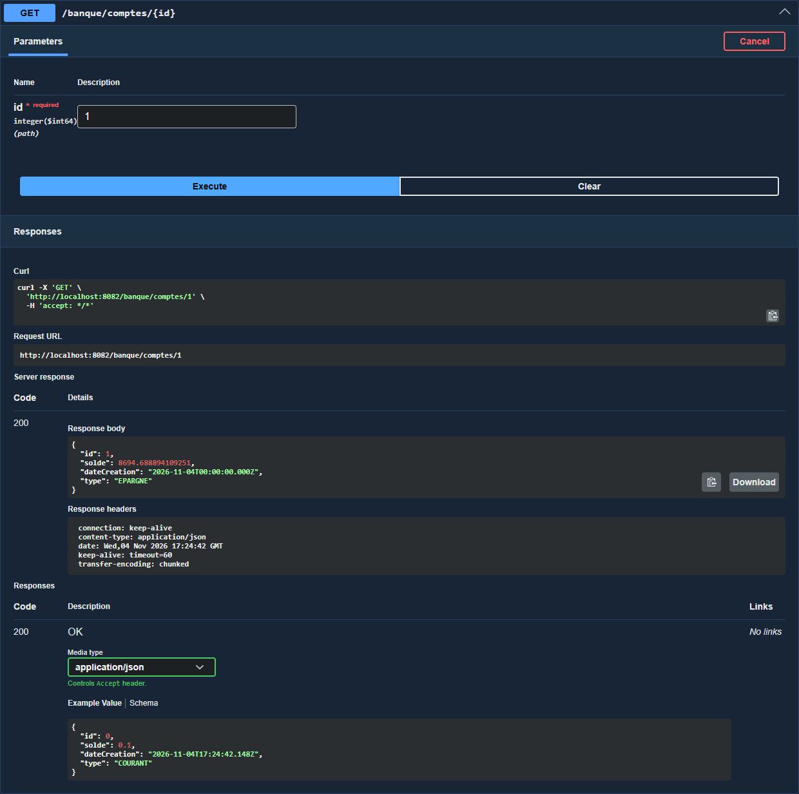
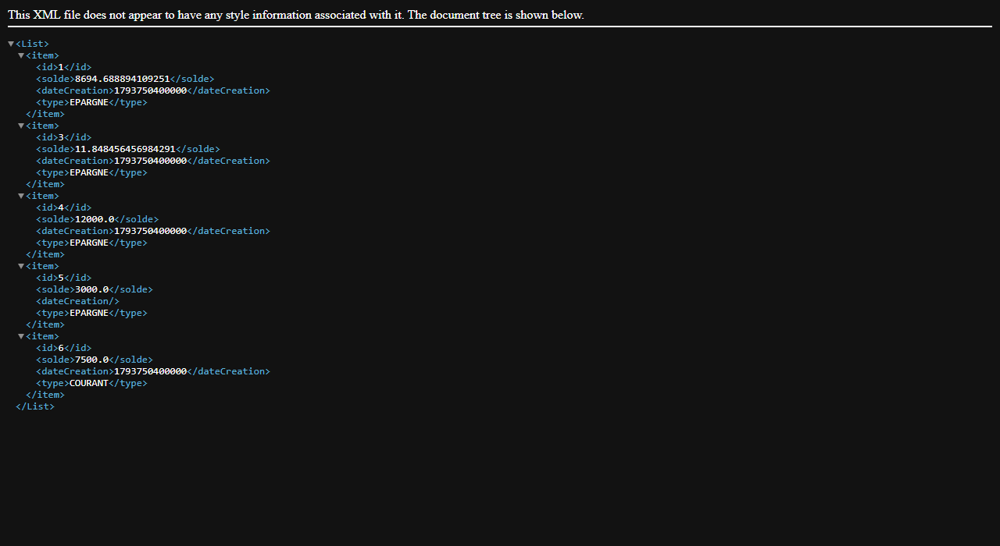
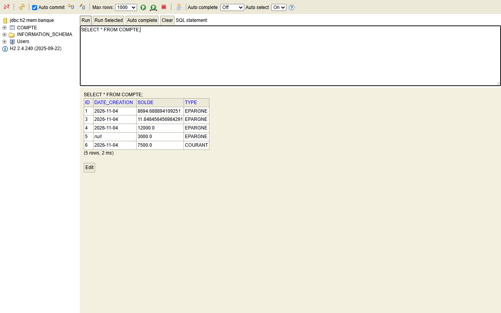

# TP8 – API REST avec Spring MVC (`@RestController`), JSON / XML et Swagger

Dans ce TP, j'ai construit une API REST pour gérer des **comptes bancaires** avec **Spring Boot 4** et **Spring MVC**.
Les routes sont exposées avec `@RestController`. L'API répond en **JSON** ou en **XML**, selon l'en-tête `Accept` envoyé par le client.
Les données sont stockées dans une base **H2** en mémoire avec **Spring Data JPA**, et l'API est documentée avec **Swagger UI** (springdoc-openapi).

---

## Sommaire

1. [Objectifs](#1-objectifs)
2. [Technologies utilisées](#2-technologies-utilisées)
3. [Structure du projet](#3-structure-du-projet)
4. [Explication du code](#4-explication-du-code)
5. [Endpoints de l'API](#5-endpoints-de-lapi)
6. [Lancer le projet](#6-lancer-le-projet)
7. [Tests et captures d'écran](#7-tests-et-captures-décran)
8. [Problèmes rencontrés](#8-problèmes-rencontrés)
9. [Conclusion](#9-conclusion)

---

## 1. Objectifs

- Créer une API REST CRUD avec `@RestController`, `@GetMapping`, `@PostMapping`, `@PutMapping` et `@DeleteMapping`.
- Utiliser la **négociation de contenu** : renvoyer et accepter du JSON **et** du XML grâce à `produces` et `consumes`.
- Persister les comptes dans une base H2 en mémoire avec Spring Data JPA.
- Documenter et tester l'API avec Swagger UI.
- Tester l'API de plusieurs façons : tests JUnit (MockMvc), `curl`, Swagger UI, navigateur et console H2.

## 2. Technologies utilisées

| Outil | Version | Rôle |
|-------|---------|------|
| Java | 25 | Langage |
| Spring Boot | 4.1.2 | Framework principal |
| Spring MVC (`spring-boot-starter-webmvc`) | 7.x | Couche web REST |
| Spring Data JPA + Hibernate | 7.4 | Accès aux données |
| H2 (+ `spring-boot-h2console`) | 2.4 | Base de données en mémoire et sa console web |
| Jackson (`jackson-dataformat-xml`) | – | Sérialisation JSON et XML |
| Lombok | – | Génère getters, setters, constructeurs et `toString` |
| springdoc-openapi (`webmvc-ui`) | 3.2.0 | Documentation Swagger |
| JUnit 5 + MockMvc | – | Tests d'intégration |
| Maven Wrapper | – | Build |

## 3. Structure du projet

```
tp8
├── pom.xml
├── screenshots/                                 ← captures utilisées dans ce README
└── src
    ├── main
    │   ├── java/com/example/tp8
    │   │   ├── Tp8Application.java              ← point d'entrée + données de départ
    │   │   ├── controller/CompteController.java ← contrôleur REST (CRUD)
    │   │   ├── model/Compte.java                ← entité JPA
    │   │   ├── model/TypeCompte.java            ← enum COURANT / EPARGNE
    │   │   └── repository/CompteRepository.java ← interface JpaRepository
    │   └── resources/application.properties
    └── test/java/com/example/tp8
        ├── CompteControllerTest.java            ← tests des endpoints (MockMvc)
        └── Tp8ApplicationTests.java             ← test de chargement du contexte
```

Le projet suit une architecture en couches classique :

```
Client (curl / navigateur / Swagger)
        │  HTTP (JSON ou XML)
        ▼
CompteController   (couche web – Spring MVC)
        │
        ▼
CompteRepository   (couche d'accès aux données – Spring Data JPA)
        │
        ▼
Base H2 en mémoire (jdbc:h2:mem:banque)
```

## 4. Explication du code

### 4.1 L'entité `Compte`

```java
@Entity
@Data @NoArgsConstructor @AllArgsConstructor
public class Compte {
    @Id
    @GeneratedValue(strategy = GenerationType.IDENTITY)
    private Long id;
    private double solde;

    @Temporal(TemporalType.DATE)
    private Date dateCreation;

    @Enumerated(EnumType.STRING)
    private TypeCompte type;
}
```

- `@Entity` : la classe devient une table `COMPTE` dans la base.
- `@Id` + `@GeneratedValue(IDENTITY)` : l'identifiant est la clé primaire, générée automatiquement par la base.
- `@Enumerated(EnumType.STRING)` : le type est stocké en texte (`COURANT` / `EPARGNE`) et non en numéro.
- Toutes les annotations viennent de `jakarta.persistence` (voir [problème 8.1](#81-erreur--lentité-na-pas-de-clé-primaire)).
- Contrairement à JAXB, Jackson XML n'a besoin d'aucune annotation pour convertir l'objet en XML : la balise racine prend le nom de la classe (`<Compte>`).

### 4.2 Le repository

```java
@Repository
public interface CompteRepository extends JpaRepository<Compte, Long> { }
```

Le repository est une interface vide. Spring Data génère automatiquement `findAll`, `findById`, `save` et `delete`.

### 4.3 Le contrôleur REST

`CompteController` est annoté `@RestController` et `@RequestMapping("/banque")`.
Chaque méthode déclare les formats qu'elle produit (`produces`) et accepte (`consumes`) :

```java
@GetMapping(value = "/comptes", produces = { "application/json", "application/xml" })
public List<Compte> getAllComptes() {
    return compteRepository.findAll();
}

@GetMapping(value = "/comptes/{id}", produces = { "application/json", "application/xml" })
public ResponseEntity<Compte> getCompteById(@PathVariable Long id) {
    return compteRepository.findById(id)
            .map(compte -> ResponseEntity.ok().body(compte))
            .orElse(ResponseEntity.notFound().build());
}
```

Spring compare l'en-tête `Accept` de la requête avec la liste `produces`, puis choisit le convertisseur adapté :
Jackson JSON pour `application/json` et Jackson XML pour `application/xml`.
Les méthodes `GET /{id}`, `PUT` et `DELETE` renvoient un `ResponseEntity`, ce qui permet de répondre **404 Not Found** quand le compte n'existe pas.

### 4.4 Le support XML

Il suffit d'ajouter la dépendance suivante :

```xml
<dependency>
    <groupId>com.fasterxml.jackson.dataformat</groupId>
    <artifactId>jackson-dataformat-xml</artifactId>
</dependency>
```

Quand Spring Boot la trouve sur le classpath, il enregistre automatiquement un convertisseur XML. Il n'y a rien à configurer.
Il reste seulement à déclarer `application/xml` dans `produces` / `consumes`, et au client d'envoyer l'en-tête `Accept: application/xml`.

### 4.5 Les données de départ

Au démarrage, un `CommandLineRunner` insère trois comptes avec un solde aléatoire, puis les affiche dans la console
(voir la [capture 7.1](#71-démarrage-de-lapplication)) :

```java
@Bean
CommandLineRunner start(CompteRepository compteRepository) {
    return args -> {
        compteRepository.save(new Compte(null, Math.random() * 9000, new Date(), TypeCompte.EPARGNE));
        compteRepository.save(new Compte(null, Math.random() * 9000, new Date(), TypeCompte.COURANT));
        compteRepository.save(new Compte(null, Math.random() * 9000, new Date(), TypeCompte.EPARGNE));
        compteRepository.findAll().forEach(c -> System.out.println(c.toString()));
    };
}
```

### 4.6 `application.properties`

```properties
spring.application.name=tp8
server.port=8082

# Base H2 en mémoire
spring.datasource.url=jdbc:h2:mem:banque
spring.datasource.driverClassName=org.h2.Driver
spring.datasource.username=sa
spring.datasource.password=
spring.jpa.hibernate.ddl-auto=update

# Console web H2
spring.h2.console.enabled=true
spring.h2.console.path=/h2-console
```

## 5. Endpoints de l'API

URL de base : `http://localhost:8082/banque`

| Méthode | URL | Description | Corps de la requête | Réponse |
|---------|-----|-------------|---------------------|---------|
| GET | `/comptes` | Liste tous les comptes | – | 200 + liste |
| GET | `/comptes/{id}` | Renvoie un compte | – | 200 + compte, ou 404 |
| POST | `/comptes` | Ajoute un compte | JSON ou XML | 200 + compte créé |
| PUT | `/comptes/{id}` | Modifie le solde, la date et le type | JSON ou XML | 200 + compte modifié, ou 404 |
| DELETE | `/comptes/{id}` | Supprime un compte | – | 200, ou 404 |

Exemple de corps JSON :

```json
{
  "solde": 7500.0,
  "dateCreation": "2026-11-04",
  "type": "COURANT"
}
```

Le même compte au format XML :

```xml
<Compte>
  <solde>7500.0</solde>
  <type>COURANT</type>
</Compte>
```

## 6. Lancer le projet

**Prérequis :** JDK 25. Maven n'est pas nécessaire, car le wrapper `mvnw` est fourni.
La variable `JAVA_HOME` doit pointer vers un JDK 25 (voir [problème 8.4](#84-release-version-25-not-supported)).

```bash
# 1. Cloner le dépôt
git clone <url-du-depot>
cd tp8

# 2. Lancer l'application
./mvnw spring-boot:run          # Linux / macOS / Git Bash
mvnw.cmd spring-boot:run        # Windows (cmd)

# ou bien construire le jar puis l'exécuter
./mvnw clean package
java -jar target/tp8-0.0.1-SNAPSHOT.jar
```

Une fois l'application démarrée :

| Ressource | Adresse |
|-----------|---------|
| API | http://localhost:8082/banque/comptes |
| Swagger UI | http://localhost:8082/swagger-ui/index.html |
| Spécification OpenAPI | http://localhost:8082/v3/api-docs |
| Console H2 | http://localhost:8082/h2-console (URL JDBC : `jdbc:h2:mem:banque`, utilisateur `sa`, sans mot de passe) |

Pour lancer les tests :

```bash
./mvnw test
```

## 7. Tests et captures d'écran

### 7.1 Démarrage de l'application

Tomcat démarre sur le port 8082 et la base `jdbc:h2:mem:banque` est créée.
Les trois comptes insérés par le `CommandLineRunner` s'affichent ensuite dans la console.



### 7.2 Tests JUnit (`./mvnw test`)

La classe `CompteControllerTest` charge toute l'application (`@SpringBootTest`) et envoie des requêtes HTTP au contrôleur avec **MockMvc** (`@AutoConfigureMockMvc`).
Chaque test affiche la requête, le statut et le corps de la réponse. Elle couvre dix cas :

| Test | Ce qui est vérifié |
|------|--------------------|
| `getComptesJson` | GET de la liste en JSON → 200, type `application/json` |
| `getComptesXml` | GET de la liste en XML → 200, type `application/xml` |
| `getCompteParIdJson` | GET du compte 1 en JSON → `"id": 1` |
| `getCompteParIdXml` | GET du compte 1 en XML → `<Compte><id>1</id>…` |
| `getCompteInexistant` | GET du compte 999 → 404 |
| `postCompteJson` | POST d'un compte en JSON → id généré, solde `7500.0` |
| `postCompteXml` | POST d'un compte en XML → solde `3000.0`, type `EPARGNE` |
| `putCompte` | PUT du compte 1 → nouveau solde `9999.0` |
| `deleteCompte` | DELETE du compte 2 → 200, puis GET → 404 |
| `deleteCompteInexistant` | DELETE du compte 999 → 404 |

Résultat : **11 tests, 0 échec** (le onzième est `contextLoads`).



### 7.3 Tests manuels avec `curl`

J'ai enchaîné toutes les opérations CRUD : lister en JSON, lire un compte en XML, créer en JSON puis en XML, modifier, supprimer, puis relister.
La dernière commande montre que le compte 2 a bien disparu, que le compte 4 a été modifié et que le compte 5 a été créé depuis du XML.



Commandes utilisées :

```bash
curl -H "Accept: application/json" http://localhost:8082/banque/comptes
curl -H "Accept: application/xml"  http://localhost:8082/banque/comptes/1
curl -X POST -H "Content-Type: application/json" -d '{"solde":7500.0,"dateCreation":"2026-11-04","type":"COURANT"}' http://localhost:8082/banque/comptes
curl -X POST -H "Content-Type: application/xml" -H "Accept: application/xml" -d '<Compte><solde>3000.0</solde><type>EPARGNE</type></Compte>' http://localhost:8082/banque/comptes
curl -X PUT  -H "Content-Type: application/json" -d '{"solde":12000.0,"dateCreation":"2026-11-04","type":"EPARGNE"}' http://localhost:8082/banque/comptes/4
curl -X DELETE http://localhost:8082/banque/comptes/2
```

### 7.4 Swagger UI

Vue d'ensemble : springdoc détecte automatiquement les 5 opérations du `CompteController` et le schéma `Compte`.



**POST /banque/comptes** : création d'un compte. La réponse contient l'`id` généré par la base.



**GET /banque/comptes** exécuté depuis Swagger :



**GET /banque/comptes/{id}** avec `id = 1` :



### 7.5 Réponse XML dans le navigateur

Le navigateur envoie `Accept: text/html,application/xml,...`. Le JSON n'étant pas dans cette liste, Spring choisit XML.
Jackson enveloppe la liste dans une balise `<List>` et chaque compte dans une balise `<item>`.



### 7.6 Console H2

La console est accessible sur `/h2-console`. On s'y connecte avec l'URL `jdbc:h2:mem:banque` et l'utilisateur `sa` :


La requête `SELECT * FROM COMPTE` confirme que les opérations faites via l'API sont bien enregistrées dans la table :



## 8. Problèmes rencontrés

### 8.1 Erreur : « l'entité n'a pas de clé primaire »

IntelliJ signalait que `Compte` n'avait pas de clé primaire, alors que le champ `id` portait bien `@Id`.
La cause était l'import : `org.springframework.data.annotation.Id` (l'`@Id` de Spring Data) au lieu de `jakarta.persistence.Id`.
Un import explicite l'emporte sur `import jakarta.persistence.*`, donc JPA ne voyait aucun `@Id`.
Le fichier importait aussi `org.hibernate.annotations.Temporal` et l'ancien package `javax.persistence.*`, qui n'est plus utilisé depuis Spring Boot 3.
**Solution :** ne garder que `import jakarta.persistence.*;`.

### 8.2 Import introuvable dans `CompteRepository`

Le code copié depuis l'énoncé importait `ma.rest.spring.entities.Compte`, un package qui n'existe pas dans ce projet.
**Solution :** importer `com.example.tp8.model.Compte`.

### 8.3 Faute de frappe dans `application.properties`

La ligne `pring.datasource.url=jdbc:h2:mem:banque` (sans le « s ») était ignorée.
Spring Boot créait alors une base au nom aléatoire, et la connexion à `jdbc:h2:mem:banque` dans la console H2 affichait une base vide.
**Solution :** corriger la clé en `spring.datasource.url`.

### 8.4 `release version 25 not supported`

`./mvnw` utilise le JDK indiqué par `JAVA_HOME`. Sur ma machine, `JAVA_HOME` pointait vers le JDK d'Android Studio, plus ancien que Java 25.
**Solution :** faire pointer `JAVA_HOME` vers un JDK 25 avant de lancer Maven, par exemple dans Git Bash :

```bash
export JAVA_HOME="/c/Program Files/Eclipse Adoptium/jdk-25.0.4.7-hotspot"
```

### 8.5 Dates différentes entre JSON et XML

En JSON, la date apparaît au format ISO (`"2026-11-04T00:00:00.000Z"`). En XML, elle apparaît sous forme de timestamp (`1793750400000`).
Spring Boot 4 utilise Jackson 3 pour le JSON. La dépendance XML `com.fasterxml.jackson.dataformat` appartient à Jackson 2, qui écrit les dates en timestamp par défaut.
Ce n'est pas bloquant, mais on peut harmoniser les deux formats en passant à la dépendance Jackson 3 `tools.jackson.dataformat:jackson-dataformat-xml`.

## 9. Conclusion

Ce TP m'a montré qu'avec Spring MVC, une API REST complète tient en très peu de code :
un `JpaRepository` vide pour l'accès aux données, et un `@RestController` pour les routes.
La négociation de contenu est le point le plus intéressant : en ajoutant une seule dépendance (`jackson-dataformat-xml`) et les attributs `produces` / `consumes`,
une seule méthode Java sert à la fois du JSON et du XML. springdoc génère ensuite la documentation Swagger sans aucune configuration.

Pistes d'amélioration :
- renvoyer **201 Created** pour la création et **204 No Content** pour la suppression ;
- ajouter une couche *service* et des DTO pour ne pas exposer directement l'entité JPA ;
- valider les données avec `@Valid` (par exemple un solde positif et un type obligatoire) ;
- remplacer `Date` + `@Temporal` (déprécié) par `java.time.LocalDate`.

---

**Auteur :** Mouad Handaji – Module Micro-services
