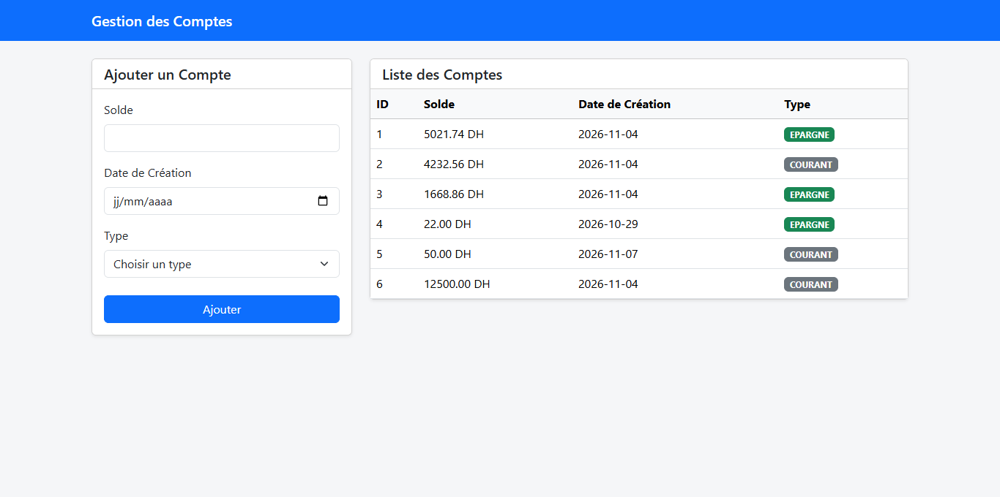
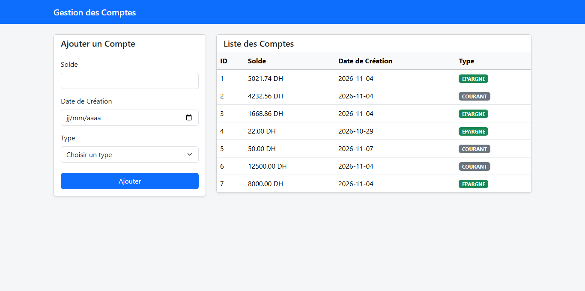
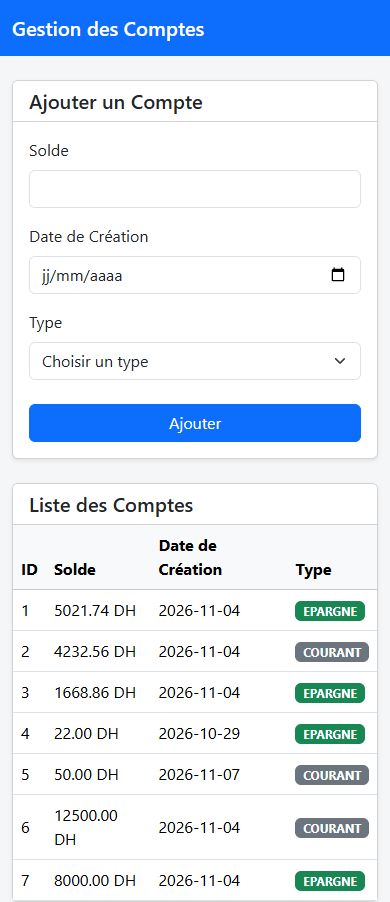

# TP9 – Front-end React pour l'API REST des comptes bancaires

Dans ce TP, j'ai construit une interface web avec **React** (et **Vite**) qui consomme l'API REST Spring Boot réalisée au [TP8](../tp8).
L'application affiche la liste des comptes bancaires et permet d'en ajouter un nouveau à l'aide d'un formulaire.
Les appels HTTP sont faits avec **Axios**, et la mise en page utilise **Bootstrap 5**.

Le point le plus important de ce TP a été de comprendre et de corriger l'erreur **CORS** qui bloquait la communication entre le front-end et le back-end.



---

## Sommaire

1. [Objectifs](#1-objectifs)
2. [Technologies utilisées](#2-technologies-utilisées)
3. [Architecture](#3-architecture)
4. [Structure du projet](#4-structure-du-projet)
5. [Explication du code](#5-explication-du-code)
6. [Le problème CORS et sa solution](#6-le-problème-cors-et-sa-solution)
7. [Lancer le projet](#7-lancer-le-projet)
8. [Captures d'écran](#8-captures-décran)
9. [Problèmes rencontrés](#9-problèmes-rencontrés)
10. [Améliorations possibles](#10-améliorations-possibles)
11. [Conclusion](#11-conclusion)

---

## 1. Objectifs

- Créer une application React avec Vite.
- Consommer une API REST Spring Boot avec Axios (`GET` et `POST`).
- Utiliser les hooks `useState` et `useEffect` pour gérer l'état et charger les données.
- Construire un formulaire contrôlé en React.
- Mettre en forme l'interface avec Bootstrap.
- Comprendre la politique **Same-Origin** du navigateur et configurer **CORS** côté Spring Boot.

## 2. Technologies utilisées

| Outil | Version | Rôle |
|-------|---------|------|
| React | 19.3 | Bibliothèque UI |
| Vite | 8.3 | Serveur de développement et build |
| Axios | 1.21 | Requêtes HTTP vers l'API |
| Bootstrap | 5.3 | Mise en page et composants CSS |
| Oxlint | 1.89 | Linter |
| Node.js | 24 | Environnement d'exécution |
| Spring Boot (back-end du TP8) | 4.1 | API REST `/banque/comptes` |

## 3. Architecture

```
┌──────────────────────────────┐        HTTP (JSON)        ┌──────────────────────────────┐
│  Front-end React (Vite)      │  ───────────────────────► │  Back-end Spring Boot (TP8)  │
│  http://localhost:5173       │   GET  /banque/comptes    │  http://localhost:8082       │
│                              │   POST /banque/comptes    │                              │
│  CompteForm  ·  CompteList   │  ◄─────────────────────── │  CompteController → H2       │
└──────────────────────────────┘  Access-Control-Allow-... └──────────────────────────────┘
```

Le front-end et le back-end tournent sur **deux ports différents**, donc sur **deux origines différentes**.
C'est pour cela qu'une configuration CORS est nécessaire côté back-end (voir [section 6](#6-le-problème-cors-et-sa-solution)).

## 4. Structure du projet

```
tp9
├── index.html                    ← page HTML qui contient <div id="root">
├── package.json                  ← dépendances et scripts npm
├── vite.config.js                ← configuration Vite (plugin React)
├── screenshots/                  ← captures utilisées dans ce README
└── src
    ├── main.jsx                  ← point d'entrée : importe Bootstrap et monte <App />
    ├── index.css                 ← style global (couleur de fond)
    ├── config.js                 ← URL de base de l'API
    ├── App.jsx                   ← mise en page : barre de navigation + 2 colonnes
    └── components
        ├── CompteForm.jsx        ← formulaire d'ajout d'un compte (POST)
        └── CompteList.jsx        ← tableau de la liste des comptes (GET)
```

## 5. Explication du code

### 5.1 `config.js` – l'URL de l'API

L'adresse du back-end est définie à un seul endroit, puis importée par les composants :

```js
const API_BASE_URL = "http://localhost:8082/banque";

export default API_BASE_URL;
```

### 5.2 `main.jsx` – le point d'entrée

C'est ici que la feuille de style **Bootstrap** est importée. Sans cette ligne, les classes `container`, `table`, `form-control`… n'ont aucun effet.

```jsx
import 'bootstrap/dist/css/bootstrap.min.css'
import './index.css'
import App from './App.jsx'

createRoot(document.getElementById('root')).render(
  <StrictMode>
    <App />
  </StrictMode>,
)
```

### 5.3 `App.jsx` – la mise en page

`App` affiche une barre de navigation, puis une grille Bootstrap à deux colonnes :
le formulaire à gauche (`col-lg-4`) et la liste à droite (`col-lg-8`).
Sur un petit écran, les deux colonnes passent l'une sous l'autre.

```jsx
<nav className="navbar navbar-dark bg-primary mb-4">
  <div className="container">
    <span className="navbar-brand fw-semibold">Gestion des Comptes</span>
  </div>
</nav>

<main className="container">
  <div className="row g-4">
    <div className="col-lg-4"><CompteForm /></div>
    <div className="col-lg-8"><CompteList /></div>
  </div>
</main>
```

### 5.4 `CompteList.jsx` – afficher les comptes (GET)

- `useState([])` stocke la liste des comptes.
- `useEffect(..., [])` s'exécute **une seule fois**, au montage du composant, et envoie la requête `GET`.
- Si la liste est vide, une ligne « Aucun compte disponible » est affichée ; sinon, chaque compte devient une ligne du tableau.

```jsx
const [comptes, setComptes] = useState([]);

useEffect(() => {
  axios.get(`${API_BASE_URL}/comptes`)
    .then(response => setComptes(response.data))
    .catch(error => console.error(error));
}, []);
```

Pour que le tableau reste lisible :

- le solde est arrondi à 2 décimales : `Number(compte.solde).toFixed(2)` ;
- la date est raccourcie au format `AAAA-MM-JJ` : `compte.dateCreation?.slice(0, 10)` ;
- le type est affiché dans un badge (vert pour `EPARGNE`, gris pour `COURANT`) ;
- le tableau est placé dans un conteneur `table-responsive` pour qu'il ne déborde pas sur mobile.

### 5.5 `CompteForm.jsx` – ajouter un compte (POST)

Le formulaire est **contrôlé** : chaque champ met à jour l'objet `compte` dans l'état grâce à une seule fonction `handleChange`, qui utilise l'attribut `name` du champ.

```jsx
const [compte, setCompte] = useState({ solde: '', dateCreation: '', type: '' });

const handleChange = (e) => {
  setCompte({ ...compte, [e.target.name]: e.target.value });
};

const handleSubmit = (e) => {
  e.preventDefault(); // empêche le rechargement de la page
  axios.post(`${API_BASE_URL}/comptes`, compte)
    .then(() => alert('Compte ajouté'))
    .catch(error => console.error(error));
};
```

Les trois champs sont `required`, et la liste déroulante commence par une option vide « Choisir un type ».
Ainsi, on ne peut pas envoyer un compte sans type au back-end.

Exemple de corps JSON envoyé par Axios :

```json
{ "solde": "8000", "dateCreation": "2026-11-04", "type": "EPARGNE" }
```

## 6. Le problème CORS et sa solution

### 6.1 L'erreur

Au premier lancement, la liste restait vide et la console du navigateur affichait :

```
Access to XMLHttpRequest at 'http://localhost:8082/banque/comptes' from origin 'http://localhost:5173'
has been blocked by CORS policy: No 'Access-Control-Allow-Origin' header is present on the requested resource.
```

### 6.2 Pourquoi ?

Une **origine** est composée de trois éléments : **protocole + hôte + port**.

| Application | Origine |
|-------------|---------|
| Front-end React | `http://localhost:5173` |
| Back-end Spring Boot | `http://localhost:8082` |

Les ports sont différents, ce sont donc **deux origines différentes**.
Le navigateur applique la **Same-Origin Policy** : du JavaScript chargé depuis une origine ne peut pas lire la réponse d'une autre origine, **sauf si le serveur l'autorise explicitement** avec l'en-tête `Access-Control-Allow-Origin`.

Ce qui se passait :

1. Le navigateur envoie la requête avec l'en-tête `Origin: http://localhost:5173`.
2. Spring Boot traite la requête normalement et renvoie le JSON (l'API fonctionnait, d'ailleurs elle marchait dans Postman).
3. La réponse ne contient pas d'en-tête `Access-Control-Allow-Origin`.
4. Le navigateur **bloque la réponse**, et Axios reçoit une erreur.

Pour le `POST` avec `Content-Type: application/json`, le navigateur envoie d'abord une requête **preflight** `OPTIONS` pour demander l'autorisation. Elle doit, elle aussi, recevoir une réponse correcte.

> CORS est appliqué par le **navigateur**, mais il se configure sur le **serveur**.
> C'est pourquoi Postman ou `curl` ne sont pas concernés.

### 6.3 La solution : une configuration CORS globale dans le back-end (TP8)

J'ai ajouté la classe `CorsConfig` dans le projet Spring Boot (`tp8/src/main/java/com/example/tp8/config/CorsConfig.java`) :

```java
@Configuration
public class CorsConfig implements WebMvcConfigurer {

    @Override
    public void addCorsMappings(CorsRegistry registry) {
        registry.addMapping("/banque/**")                       // URLs concernées
                .allowedOrigins("http://localhost:5173")        // origine autorisée : l'app React
                .allowedMethods("GET", "POST", "PUT", "DELETE", "OPTIONS")
                .allowedHeaders("*");                           // ex. Content-Type: application/json
    }
}
```

- Un seul `addMapping("/banque/**")` suffit : le motif `/**` couvre **tous** les endpoints sous `/banque`.
- J'ai préféré cette configuration globale à l'annotation `@CrossOrigin`, qu'il faudrait répéter sur chaque contrôleur.
- J'autorise uniquement l'origine de l'application React, plutôt que `*` (toutes les origines).

### 6.4 Vérification

Avec `curl`, en simulant l'en-tête `Origin` envoyé par le navigateur :

```bash
curl -i -H "Origin: http://localhost:5173" http://localhost:8082/banque/comptes
```

```
HTTP/1.1 200
Access-Control-Allow-Origin: http://localhost:5173
Content-Type: application/json
```

Et pour la requête preflight du `POST` :

```bash
curl -i -X OPTIONS -H "Origin: http://localhost:5173" \
     -H "Access-Control-Request-Method: POST" \
     -H "Access-Control-Request-Headers: content-type" \
     http://localhost:8082/banque/comptes
```

```
HTTP/1.1 200
Access-Control-Allow-Origin: http://localhost:5173
Access-Control-Allow-Methods: GET,POST,PUT,DELETE,OPTIONS
Access-Control-Allow-Headers: content-type
Access-Control-Max-Age: 1800
```

## 7. Lancer le projet

**Prérequis :** Node.js (version 20 ou plus) et le back-end du [TP8](../tp8) (JDK 25).

### 7.1 Démarrer le back-end (TP8)

```bash
cd tp8
./mvnw spring-boot:run          # Linux / macOS / Git Bash
mvnw.cmd spring-boot:run        # Windows (cmd)
```

L'API est alors disponible sur http://localhost:8082/banque/comptes.

### 7.2 Démarrer le front-end (TP9)

```bash
cd tp9
npm install
npm run dev
```

Ouvrir ensuite http://localhost:5173 dans le navigateur.

### 7.3 Autres scripts

| Commande | Rôle |
|----------|------|
| `npm run dev` | Lance le serveur de développement Vite (rechargement à chaud) |
| `npm run build` | Construit la version de production dans `dist/` |
| `npm run preview` | Sert localement la version construite |
| `npm run lint` | Analyse le code avec Oxlint |

> L'URL du back-end se modifie dans `src/config.js`.
> Si le front-end tourne sur un autre port que `5173`, il faut aussi mettre à jour `allowedOrigins` dans `CorsConfig` (TP8).

## 8. Captures d'écran

### 8.1 Page principale

Le formulaire est à gauche et la liste des comptes, chargée depuis l'API, est à droite.


### 8.2 Formulaire rempli

Saisie d'un nouveau compte : solde de 8000, date du jour, type Épargne.


### 8.3 Liste après l'ajout

Après la validation (message « Compte ajouté ») et le rechargement de la page, le nouveau compte apparaît en dernière ligne (id 7).



### 8.4 Affichage mobile

Sur un petit écran, la grille Bootstrap place le formulaire au-dessus de la liste.



## 9. Problèmes rencontrés

### 9.1 Erreur CORS

La requête vers le back-end était bloquée par le navigateur.
**Solution :** ajout de la classe `CorsConfig` côté Spring Boot (voir [section 6](#6-le-problème-cors-et-sa-solution)).

### 9.2 Bootstrap installé mais sans effet

Le paquet `bootstrap` figurait dans `package.json`, mais sa feuille de style n'était jamais importée, et la page gardait le style du modèle Vite.
**Solution :** ajout de `import 'bootstrap/dist/css/bootstrap.min.css'` dans `main.jsx`, puis suppression du CSS du modèle Vite (`App.css` et le contenu de `index.css`).

### 9.3 URL du `POST` non interprétée

```js
axios.post('${API_BASE_URL}/comptes', compte)   // ✗ guillemets simples
```

Avec des guillemets simples, `${...}` n'est pas remplacé : l'URL envoyée était littéralement le texte `${API_BASE_URL}/comptes`. De plus, `API_BASE_URL` n'était pas importé dans ce fichier.
**Solution :** utiliser des **backticks** (template literal) et importer la constante.

```js
import API_BASE_URL from '../config';
axios.post(`${API_BASE_URL}/comptes`, compte)   // ✓
```

### 9.4 Condition inversée pour la liste vide

```jsx
{!comptes.length == 0 ? <h3>Aucun compte disponible</h3> : ...}   // ✗
```

Le message « Aucun compte disponible » s'affichait justement quand il **y avait** des comptes.
Il y avait aussi un `<h3>` directement dans `<tbody>`, ce qui n'est pas du HTML valide.
**Solution :** `comptes.length === 0`, et le message est placé dans une vraie ligne de tableau `<tr><td colSpan="4">`.

### 9.5 Type de compte vide

La liste déroulante n'avait pas d'option vide : si l'utilisateur ne la touchait pas, `type` restait `''` et le back-end recevait une valeur d'énumération invalide.
**Solution :** ajout d'une option « Choisir un type » désactivée, et de l'attribut `required` sur les champs.

### 9.6 Tableau qui débordait sur mobile

Sur un écran étroit, la colonne « Type » sortait de l'écran.
**Solution :** placer le tableau dans un conteneur Bootstrap `table-responsive`, et raccourcir l'affichage du solde et de la date.

## 10. Améliorations possibles

- **Rafraîchir la liste automatiquement après un ajout**, sans recharger la page. Il faudrait remonter l'état `comptes` dans `App` et passer une fonction de rappel à `CompteForm`.
- Ajouter la **modification** (`PUT`) et la **suppression** (`DELETE`) d'un compte depuis le tableau. Le back-end les propose déjà.
- Remplacer `alert()` par un message Bootstrap (`alert alert-success`) et afficher les erreurs de l'API à l'utilisateur.
- Utiliser une variable d'environnement Vite (`import.meta.env.VITE_API_URL`) au lieu d'une URL écrite en dur dans `config.js`.

## 11. Conclusion

Ce TP m'a permis de relier un front-end React à l'API REST Spring Boot du TP8.
J'ai utilisé `useState` et `useEffect` pour charger et afficher les données, un formulaire contrôlé pour en envoyer de nouvelles, et Bootstrap pour une interface propre et responsive.

Surtout, j'ai compris que l'erreur **CORS** ne vient pas d'un bug dans React : c'est le navigateur qui protège l'utilisateur, et c'est au **serveur** de déclarer quelles origines il accepte.
Une petite classe de configuration côté Spring Boot a suffi pour que les deux applications communiquent.
